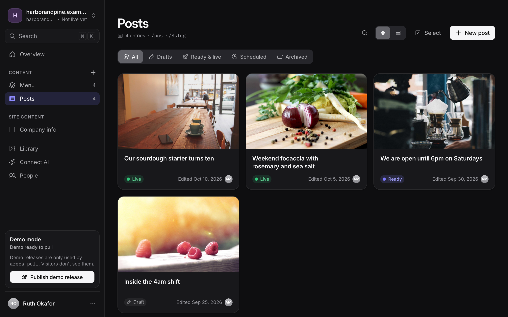
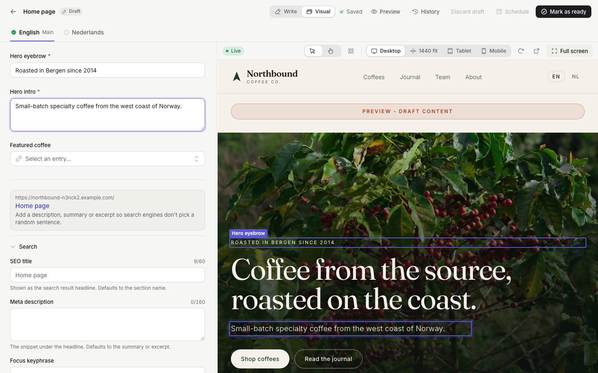
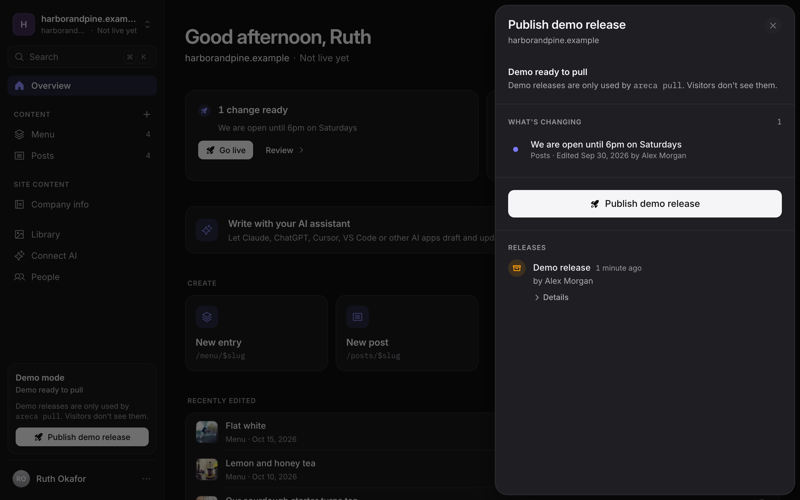
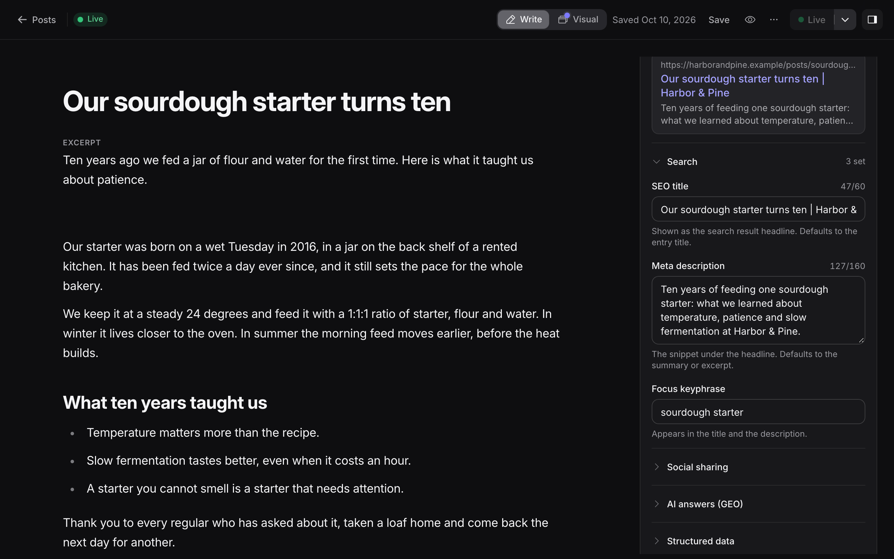
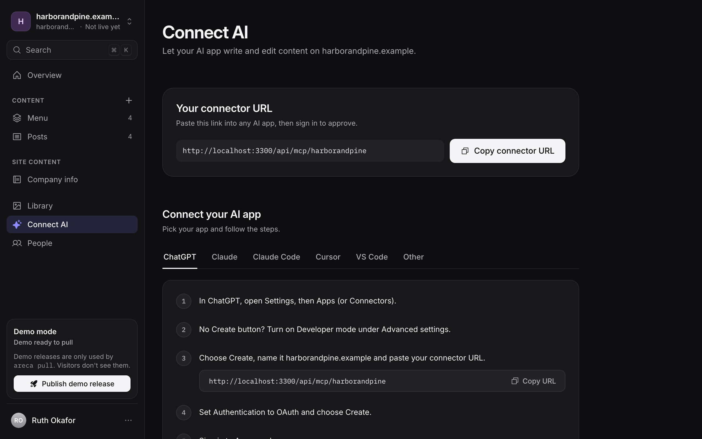

<div align="center">


# Areca CMS

**The open-source CMS for agencies that run many client websites.**

Clients write and approve their own content. Your sites stay fast, static and fully yours.

[Website](https://arecacms.com) · [Documentation](https://docs.arecacms.com) · [Live demo](https://demo.arecacms.com) · [Quick start](#quick-start)

[](LICENSE)
[](https://github.com/seirai-dev/areca-cms/releases)
[](https://www.npmjs.com/package/@areca-cms/site-sdk)
[](https://www.npmjs.com/package/@areca-cms/skills)

</div>



## Why Areca CMS

Most headless CMSs are built for one company with one website. Agencies have the opposite problem: dozens of clients, each with a site or two, each with people who should only see their own content.

Areca CMS is built around that. One installation holds all your clients. Each client gets its own sites, owners and editors, and your agency admins see everything. Editors write drafts, owners mark them ready, and **Go live** freezes the approved content into a snapshot and deploys the site. The website pulls that snapshot while it builds, so visitors get static pages and never touch the CMS.

- **Built for agencies.** Clients, sites and roles per client (owner, editor), an agency dashboard across all of them, and your own branding on the CMS.
- **Visual editor.** Edit next to a live preview of the real site, and click any part of the page to jump to its field.
- **A safe publishing flow.** Draft → ready → live, with scheduling, release history, rollback and health checks. A failed deploy never replaces the live site.
- **Made for AI.** Every site has an MCP server, so Claude, ChatGPT, Cursor and other AI apps can write drafts with the same permissions as the person who connected them. [Agent skills](packages/skills) teach coding agents to wire up a new site.
- **SEO and AI answers.** Search, social and structured-data fields on every entry, with optional AI suggestions through OpenRouter.
- **Multilingual content**, rich text with code blocks, a media library, and site-wide content such as company info.
- **Deploys where you do.** Built-in adapters for Dokploy and Cloudflare (Pages and Workers), and a throwaway development environment per site.
- **Typed from schema to page.** Define content in `areca.config.ts`, and `@areca-cms/site-sdk` generates types for every collection.
- **Secure by default.** Two-factor authentication, Google and Microsoft sign-in, step-up checks for sensitive actions, and a tested permissions matrix.

<table>
  <tr>
    <td width="50%"><br><sub><b>Visual editor:</b> click the page to edit it.</sub></td>
    <td width="50%"><br><sub><b>Go live:</b> see exactly what changes before it ships.</sub></td>
  </tr>
  <tr>
    <td width="50%"><br><sub><b>SEO built in:</b> search, social and AI-answer fields.</sub></td>
    <td width="50%"><br><sub><b>Connect AI:</b> one URL for Claude, ChatGPT or Cursor.</sub></td>
  </tr>
</table>

## Quick start

### 1. Run the CMS

You need Docker with Compose v2. This starts the CMS with PostgreSQL, Redis, S3-compatible storage and a test inbox:

```sh
git clone https://github.com/seirai-dev/areca-cms.git
cd areca-cms/docker
cp .env.example .env    # then set the secrets, see the comments in the file
docker compose up -d --wait
```

Open <http://localhost:3000/setup> and create the first admin. The setup token is printed in `docker compose logs cms`. The [Docker quick start](https://docs.arecacms.com/docs/self-hosting/docker-quickstart) explains each setting, and [Production](https://docs.arecacms.com/docs/self-hosting/production) covers a public install.

### 2. Connect a website

Create a client and a site in the CMS and copy the site token. Then, in your website project:

```sh
pnpm add @areca-cms/site-sdk
pnpm exec areca init
```

Describe your content in `areca.config.ts`, push it with `areca manifest push`, and pull the content during your build with `areca pull`. The [guide](https://docs.arecacms.com/docs/guides) walks through a full site, from the first collection to the first release.

Using an AI coding agent? Run `npx @areca-cms/skills`, then ask it to `/areca-quickstart`.

## How publishing works

```text
Draft ─► Mark as ready ─► Go live ─► Content snapshot ─► Website build pulls it ─► Deploy ─► Health check ─► Live
```

Editing a draft never changes the live site. Only approved versions go into a release, and a release only counts as live after the health check confirms the website serves it. If a deploy fails, the previous version stays live, and any earlier release can be rolled back. Previews of drafts are fetched from the CMS on demand. [Concepts](https://docs.arecacms.com/docs/concepts) explains the model in more detail.

## What's in this repository

| Path | What it is |
| --- | --- |
| [`apps/cms`](apps/cms) | The CMS: editor, API, MCP server, publishing worker and scheduler |
| [`packages/site-sdk`](packages/site-sdk) | [`@areca-cms/site-sdk`](https://www.npmjs.com/package/@areca-cms/site-sdk): the SDK and `areca` CLI that connect a website |
| [`packages/skills`](packages/skills) and [`skills`](skills) | [`@areca-cms/skills`](https://www.npmjs.com/package/@areca-cms/skills): agent skills for the SDK, the MCP server, visual editing and the quickstart |
| [`examples/demo-site`](examples/demo-site) | Northbound Coffee, a complete example website built with the SDK |
| [`apps/docs`](apps/docs) | The documentation site, [docs.arecacms.com](https://docs.arecacms.com) |
| [`apps/landing`](apps/landing) | The website, [arecacms.com](https://arecacms.com), and its product video |
| [`docker`](docker) | Docker Compose for self-hosting, and backup and recovery tools |
| [`docs`](docs) | Notes for contributors: architecture, design decisions, permissions |

The CMS is a [TanStack Start](https://tanstack.com/start) app on PostgreSQL with Drizzle, Redis and S3-compatible storage. The interface is available in English, Dutch and Turkish.

## Contributing

Contributions are welcome, from typo fixes to new features. [CONTRIBUTING.md](CONTRIBUTING.md) explains how to set up the workspace, run the tests and get a change merged. For bigger changes, please open an issue first.

Found a security problem? Please report it privately, as described in [SECURITY.md](SECURITY.md).

## Releases

The CMS is published as a Docker image, `ghcr.io/seirai-dev/areca-cms`, tagged `vX.Y.Z`, `vX.Y` and `latest`. The [GitHub releases](https://github.com/seirai-dev/areca-cms/releases) list what changed in each version, and [Upgrades](https://docs.arecacms.com/docs/self-hosting/upgrades) explains how to move between them. The npm packages have their own changelogs: [site-sdk](packages/site-sdk/CHANGELOG.md) and [skills](packages/skills/CHANGELOG.md).

## Support the project

Areca CMS is free and MIT licensed. If it saves your agency time, you can [sponsor its development on GitHub](https://github.com/sponsors/ekozf). A star on this repository helps too.

## License

[MIT](LICENSE) © 2026 Emir Kaan Özver and Areca CMS contributors
