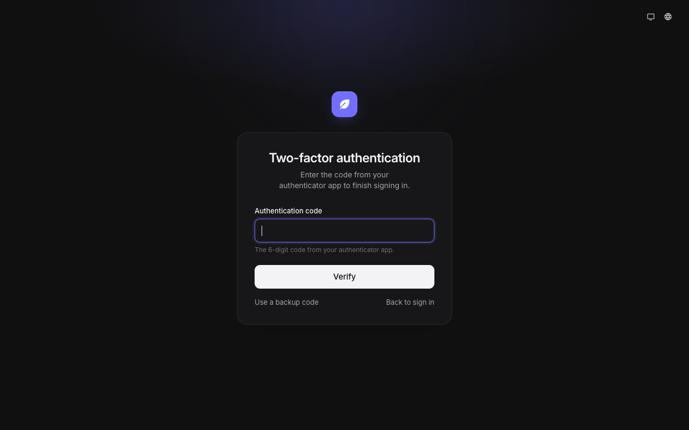
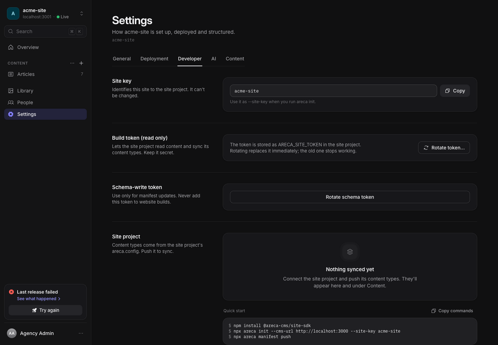
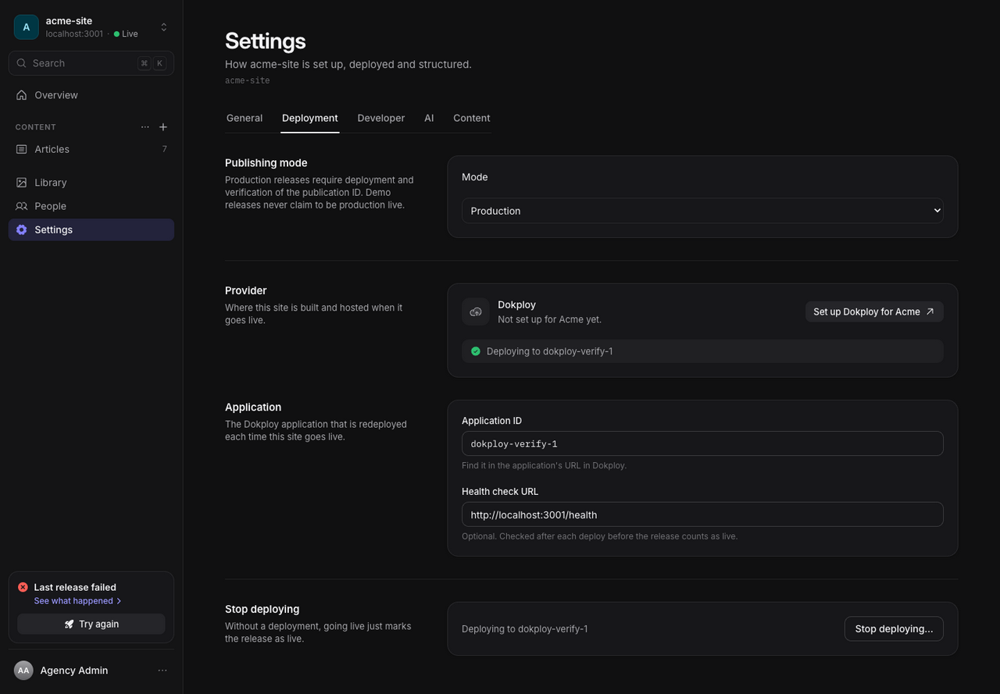
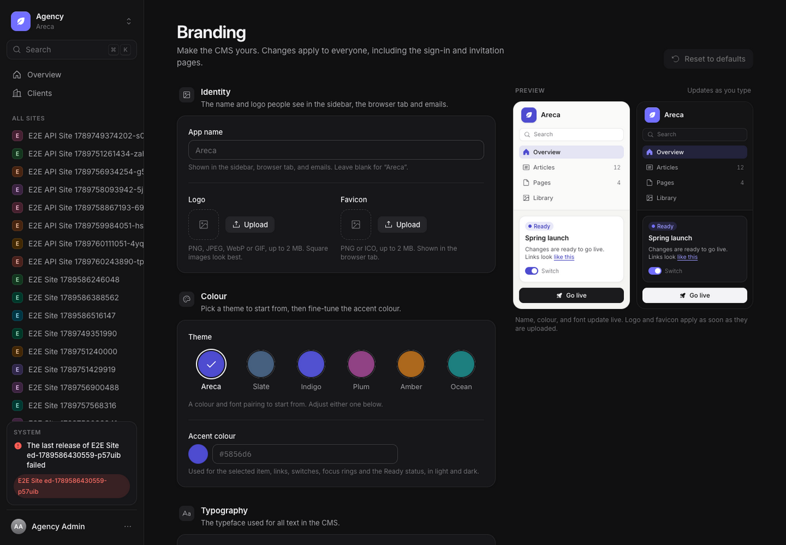
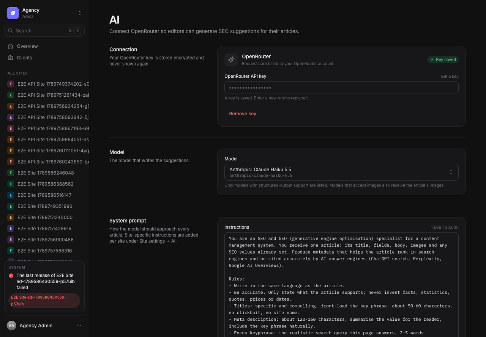

# Areca CMS agency admin guide

This guide covers first setup and ongoing administration for an agency admin. Agency admins can manage clients, sites, site configuration, global branding, AI-assisted SEO settings, users, and releases. Agency-admin accounts must have two-factor authentication enabled.

## Create a client and site

The first admin account is created at `/setup` (see [first-run onboarding](ONBOARDING.md)). Before using Agency administration, enable two-factor authentication from **Account**: confirm your account when prompted, scan the QR code with an authenticator app (or save the displayed secret), verify a current code, then copy and safely store the recovery codes. Sign-ins then require an authenticator or recovery code. Sensitive actions may ask you to verify a fresh code again.

In **Agency › Clients**, create a client. Open the client and choose **New site**. Set its name and production URL. Save the site token shown in the connection step; if you close the second step without confirming, it remains available on the client's Sites tab until you confirm you saved it. The client and its members share access to all of that client's sites.

Open a site and use **Settings**:

| Tab | Purpose |
| --- | --- |
| General | Site name, production URL, and the site deletion area. |
| Deployment | Select **Production** or **Demo** mode, configure a Dokploy application and health-check URL for Production, or intentionally use Demo mode without a production deployment. |
| Developer | Site token, token rotation, project connection state, and integration guidance. Rotating a token immediately invalidates the old token. |
| AI | Site-specific writing instructions appended to the agency's shared AI prompt. |
| Content | Review, enable, disable, create, or edit the site's content types, fields and Site content sections. |

On a client detail page, the tabs are **Sites**, **People**, **Deployment**, and **Settings**. Client **Settings** only renames the client or opens its delete area; the **Deployment** tab manages that client's Dokploy URL and API credential. Site-specific options are on that site's Settings tabs above.

Content types normally sync from the site's project manifest. The agency can also configure them in Content settings; see [Content schema reference](CONTENT_SCHEMA.md) for field types and schema behavior. To manage them, open **Settings › Content**. Use a row switch to enable or disable a type, select a row to edit its fields and route, or choose **New content type** to create one. Disabling a type keeps its entries in the CMS but excludes them from new site snapshots. Avoid deleting a site or organization as a cleanup shortcut: site deletion archives content history, and organization deletion removes that organization's data.

### Site content sections

Site content holds single sets of values that are not lists, such as company details, the home page or stats. Each section has its own fields, and editors only fill them in. You define sections; the editor's UI calls them **Site content**.

Sections appear in **Settings › Content**, in a **Site content** part below the content types. From there, you can:

- **New section** (or **Add section** in the sidebar's Site content group): name the section, then add its fields. The key cannot be `globals`, `previewGlobals`, `resolve`, `href` or `preview`.
- Set the **label** shown to editors, and turn on **Search & social (SEO)** to give the section a title, description and social preview, the way entries have.
- Set the **preview path**, such as `/` or `/about`. The CMS opens that page on the site with a signed `arecaPreview` token to show the draft. Without a path, editors cannot preview the section. The path must start with `/` and contain no query string or hash.
- Add fields with the same types as content type fields, except **slug**. For each field you can set a **Group heading**, such as **Contact**. Fields that share a heading are shown together under it in the editor. The heading is only for editors; the site still gets a flat list of values.
- **Enable or disable** a section with its switch. A disabled section is hidden from editors and left out of the next release. Its content is kept, and enabling it again brings it back.
- **Delete section** (in the section's sheet, under **Settings › Content**). Its content is archived in the deleted-content archive, not erased. The site's code must stop reading the section before you delete it.

Enabled sections with required fields must be marked ready by an owner before the site can go live. Check the section's content after changing its fields.

Sections can also be created and changed from code with `globals` in `areca.config.ts`. Pushing the config is a full sync: a section that is left out is disabled, and its content is kept.

## Connect deployment

For production publishing, configure the client's Dokploy connection under **Clients › [client] › Deployment** and verify it. Then open the site's **Settings › Deployment**, select **Production**, choose the target application, and set a health-check URL that reports the publication ID received by the deployed site. Save the settings. Production Go live is blocked until the application and publication-aware health URL are configured. The CMS worker builds a snapshot, requests deployment, and waits for the matching health check before marking the publication production-live.

For local authoring without a production deploy, select **Demo** in the site's **Settings › Deployment**. Demo releases are visibly labeled and never count as production live. They do not establish that a public site deployed successfully. Review [INTEGRATIONS.md](INTEGRATIONS.md) for operational recovery when an external deployment request has an uncertain outcome.

## Manage access

Use **Site › People** or **Clients › [client] › People** to invite client users, change Owner/Editor roles, and remove members. Owners can create and edit content, mark entries ready, schedule and manage entries, go live, roll back, manage Library deletion, and manage client people and invitations. Editors can create and edit drafts, preview, upload files, and update descriptions; they cannot mark ready, schedule, archive, delete entries, restore revisions, go live, delete files, or manage people. Agency admins can also open **Agency › People** to inspect accounts and grant or remove agency-admin access.

Treat owner access as privileged: owners can make changes live and invite other people. Agency-admin changes and sensitive destructive operations can require fresh authentication. Keep at least one trusted owner for each client.

## Branding

Open **Agency › Branding** to set the CMS name, logo, favicon, accent colour, interface font, and invitation email sender name. Use the preview to check light and dark appearance before saving. The sender name changes the display name; the sender address remains an instance mail setting. **Reset to defaults** removes custom branding and its uploaded images.

## AI-assisted SEO

Open **Agency › AI** to connect the OpenRouter provider, choose a model, and set the agency-wide prompt used for SEO suggestions. The API key is stored encrypted and is never displayed again after saving. Site-specific instructions live in **Site Settings › AI**. When configured, signed-in site members can request suggestions from an entry's SEO panel. The editor reviews and applies them; AI does not publish content.

## Releases and activity

The Agency overview summarizes sites needing attention. Open a site and use **Go live** to review or start a release. The release panel shows the snapshot, build steps, logs, failures, cancellation and rollback actions. If a deployment is uncertain, reconciliation tools preserve the one-job-per-site safety boundary; an agency admin may need to resolve an uncertain deployment with an explicit reason after confirming the upstream deployment has stopped.

**Agency › Activity** is the instance-wide audit log. A client detail page has a **View activity** action that opens the agency log filtered to that client; site activity gives the site scope. Use these records to investigate who changed content or access.

## Security and lifecycle notes

- Require two-factor authentication for agency admins and use individual accounts.
- Share site tokens only with the connected site project. Rotate a token if it may have been exposed, and update the project's environment at the same time.
- CMS files and snapshots are retained as long as authoring history references them. See [ASSET_RETENTION.md](ASSET_RETENTION.md) before planning deletion or storage cleanup.
- Application administration does not replace infrastructure backups, upgrade rehearsal, or monitoring. Use [DEPLOYMENT.md](DEPLOYMENT.md), [OPERATIONS.md](OPERATIONS.md), and [UPGRADES.md](UPGRADES.md) for those tasks.
