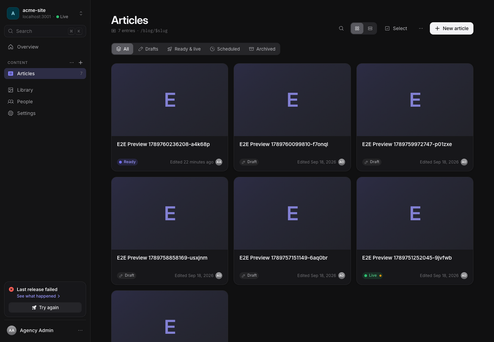
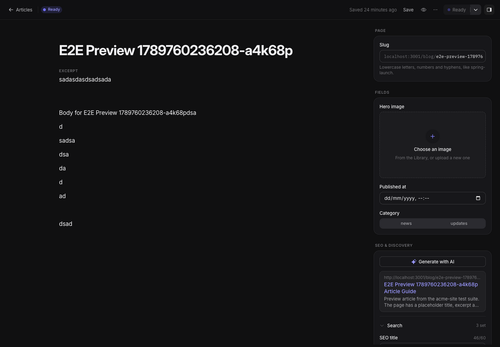
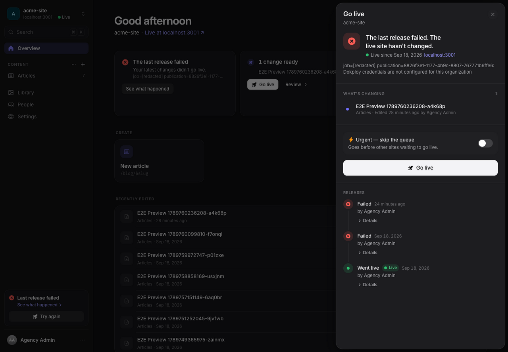
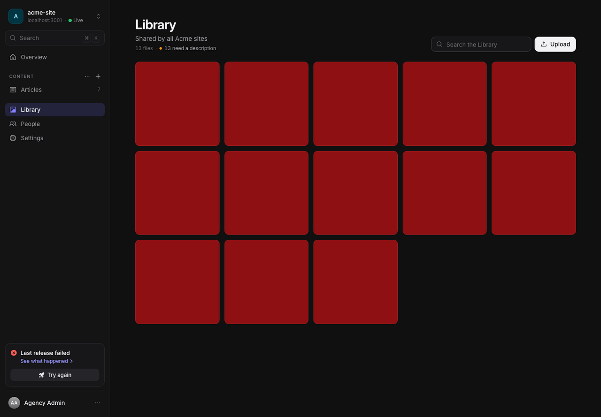
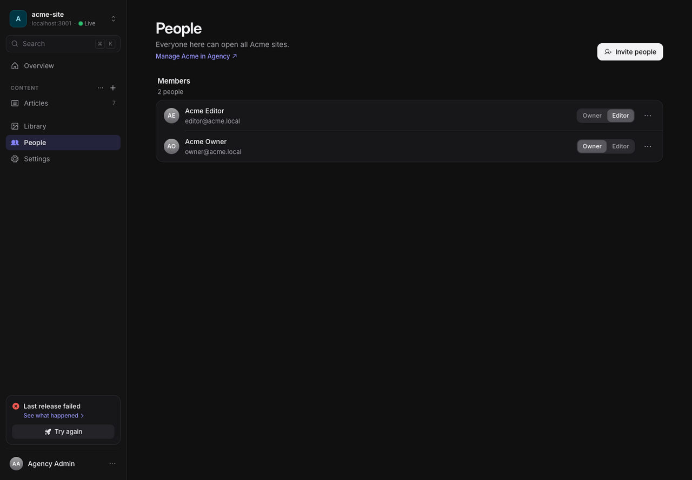
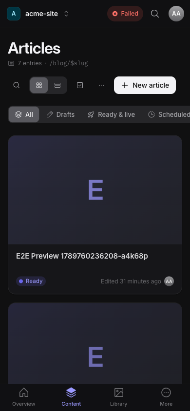

# Areca CMS editor guide

This guide is for client owners, editors, and agency staff who write and manage website content. Areca is the control room for authoring: editors change drafts here, and an owner or agency admin starts a site-wide release. The public website reads the content from that release.

## Find your workspace

After signing in, the workspace switcher at the top of the sidebar opens your recent sites and the sites you can access. A client member can work across that client's sites. Agency admins can also open the Agency workspace. Search (⌘K on Mac, Ctrl+K elsewhere) finds pages and common actions. On a phone, use the bottom tabs for Overview, Content, Library, and More.

The site **Overview** shows work that needs attention, shortcuts to create entries, recent edits, and (for owners and admins) recent activity. The site sidebar lists each content type, the site's Site content sections, the shared Library, and links you are allowed to use.

## Draft, ready, live

An entry moves through these states:

| State     | What it means                                                                                  |
| --------- | ---------------------------------------------------------------------------------------------- |
| Draft     | Only the CMS has the latest changes.                                                           |
| Ready     | An owner marked the current draft ready; it will be included the next time the site goes live. |
| Live      | The current version is in the live site release.                                               |
| Scheduled | The entry is queued for its chosen time.                                                       |
| Archived  | Kept in the CMS and omitted from the site.                                                     |

Saving an entry does not make it public. **Mark as ready** copies the draft into the version eligible for a release. **Go live** publishes a snapshot of the whole site, including all ready changes. Owners and agency admins can perform these actions. Editors can create, edit, save, and preview drafts; publish controls explain why they are unavailable.

An entry can show **Edited since ready** when its editable draft has changed since the owner approved it. The ready copy is still the one eligible for the site; ask an owner to mark the newer draft ready before the next release.

## Create and edit an entry

1. Open a content type such as Articles and choose **New article**. You can also use a create tile on Overview or the sidebar’s **+** menu.
2. Fill in the fields shown for that content type. The large title field usually supplies the entry title. The slug is generated from the title until you edit it; it must be lowercase letters, numbers, and hyphens, and unique within its content type.
3. Rich text fields support headings, emphasis, links, lists, quotes, code, images, tables, and dividers. Use the insert menu or `/` while editing. Image fields open the Library picker.
4. Changes save automatically after a short pause. The top bar shows save status; use **Save** or ⌘S / Ctrl+S to save immediately. A new entry is created after it has enough information for a valid slug.
5. Open **Details** to edit the slug, structured fields, SEO information, status, or revision history. See the [SEO guide](SEO.md) for what the search, social, and structured-data fields do. **Preview** opens the draft on the site when preview is configured.

Entry history appears after the first save. Owners and agency admins can restore a revision. Restore applies fields compatible with the current content model and keeps current draft values for removed or incompatible fields. The editor lists every skipped field and its reason; the approved version stays unchanged. If a save cannot reach the server, the editor keeps a local recovery copy in this browser and offers it when the entry is reopened. Review the recovered draft before reapplying it to the latest saved version.

## Make changes live

An owner can mark one or several entries ready from the editor or collection list. In a collection, choose **Select** to use the bulk action bar for **Mark as ready**, **Move to draft**, **Archive**, or **Delete**. Each entry is changed on its own, so one failure does not stop the others, and the entries that could not be changed are listed. The editor’s action menu also offers **Mark as ready & go live now**, **Schedule**, and, when relevant, actions to move an entry back to draft, archive it, or delete it.

Scheduling freezes the approved content and address at the time you schedule it. The editor shows **View approved scheduled version** while you can continue editing the draft separately; those later draft edits do not replace the scheduled version. The schedule uses the selected time zone and runs the release when due. Owners can cancel a scheduled version.

Use **Go live** in the site sidebar or Overview to review the site release. The panel shows changes included, release progress, errors, and prior releases. In **Production** mode, Go live builds and deploys the latest site snapshot, then verifies that the deployed site reports the publication ID. Production mode requires a configured deployment target and health-check URL; without them, publishing is blocked. The previous successful production release stays live if a new release fails. In **Demo** mode the button reads **Publish demo release**. It creates a clearly labeled demo publication without a production deploy or live verification; it does not make the website production-live.

Owners can request a rollback from a prior successful release in the Go-live panel. Areca queues a new, high-priority build using that release's saved snapshot and content hash. It does not build a new snapshot from today's drafts or erase newer drafts. A failed rollback can be retried.

## Edit site content

Some copy is not a list: company details, the home page text, stats. The site's developers or agency define these as **Site content** sections. Each section appears in the sidebar's **Site content** group, with one item per section, such as Company info or Home page. Search (⌘K or Ctrl+K) also lists them under **Go to**. If the agency has not enabled any sections for the site, the group does not appear.

A section is a single form. Fields that share a group heading, such as **Contact**, appear together under that heading. Changes save automatically, the same as entries. A section with **Search & social (SEO)** has an SEO panel, filled in the same way as an entry's.

The top bar has these actions:

- **Mark as ready** approves the current draft for the next Go live. Owners do this, like entries.
- **Schedule** and **Cancel schedule** work the same way as for entries. Owners do this.
- **Discard draft** throws away your unsaved changes to the draft and goes back to the version that is ready or live. It is not available until the section has been marked ready once. Editors and owners can use it.
- **Preview** opens the page that shows the section, with your draft. It appears only when the section has a preview page set. If it is missing, ask the agency to add one.
- **History** lists earlier versions. Owners can restore one.

Sections have no unpublish, archive or delete action. To remove a section, ask an agency admin.

A section with required fields must be marked ready at least once before the site can go live. The Go-live panel lists the section by its name, such as **Company info**, when its changes are included.

## Content languages

A site can publish in several languages. An agency admin sets them in **Settings → Languages** and chooses the main language. The main language is the fallback: visitors see it when a translation is missing.

- The entry editor has a language bar under the top bar. Each language shows whether it is complete, has missing fields, or is not started. Select a language to write it. Shared fields are marked "Same in all languages".
- **Translate empty fields** fills the empty translatable fields from the main language with the agency's AI. It saves nothing: review the draft, then save.
- An entry can't be marked ready until the languages the site requires are complete. The error names the language and the missing fields.
- The entry list shows coverage per language, and the **Missing translation** filter lists the entries that lack one.
- Changing the main language deletes nothing. Removing a language hides it and keeps its text.

The full guide, including translatable fields and URL paths, is the **Languages** page of the docs site (`apps/docs/content/docs/cms/languages.mdx`). The design is in `docs/design/content-languages.md`.

## Connect an AI app

Connect AI lets an AI app you use, such as ChatGPT, Claude, Claude Code, Cursor or VS Code, read and write one site as you. Open **Connect AI** in the site's sidebar or from the card on the Overview. Copy the site's connector URL into your app, then sign in to Areca in the browser and select **Allow** on the consent screen. Owners and agency admins can also tick **Allow going live**, which lets the app publish the whole site and is off by default. Connected apps are listed on the same page, and you can disconnect any of them at any time. Personal keys, for scripts, are under **Advanced: personal keys**. Agency admins can instead connect one agency-wide connector for every client and site, from **Agency › Connect AI**.

The AI works within your role. Editors can create and edit drafts, upload files from web addresses and edit alt text. Owners can also mark ready, schedule, archive and delete. Only a key with **Allow going live** can publish. Connections stop working when they are disconnected or unused for 90 days, and keys stop working when they expire or are revoked. Owners can see and disconnect every connection on the site. Actions made through a connected app or key appear in the activity log as **via AI**.

For setup steps and troubleshooting, see the [Connect AI guide](/docs/cms/connect-ai) in the docs site. For the tools and their rules, see [MCP.md](MCP.md).

## Development environments

Your agency may try changes on a copy of your site before they reach the live site. This copy is a **development environment**. Only agency admins can see it, so you will not find it in the CMS, and its activity is hidden from you. Its changes reach your live site only after the agency pushes them, and the agency reviews each change first. You do not need to do anything for this.

## Keyboard shortcuts

The account menu's **Keyboard shortcuts…** dialog lists the available shortcuts. The global shortcuts are ⌘K / Ctrl+K for search and commands, **g** then **o** for Overview, **g** then **l** for Library, **g** then **p** for People, and **g** then **s** for the workspace switcher. In a collection, **n** creates a new entry. **/** focuses page search (or opens the command palette when the page has no search). In the editor, ⌘S / Ctrl+S saves and ⌘. / Ctrl+. toggles Details. Single-key shortcuts pause while you type.

## Use the Library

The Library is shared across all sites in a client. It accepts JPEG, PNG, WebP, GIF, and PDF uploads, with a 20 MiB limit per file. Image fields select images; PDFs remain library files. Upload from the Library or from an image field; you can also drop files onto the Library page. Search by filename, open an item to edit its description (alt text), or open/copy its file link. Image files without descriptions can be filtered from the Library header.

Editors and owners can upload and update descriptions. Only owners and agency admins can delete files. A file that is still used by content or retained history cannot be deleted; remove all references first.

Uploaded files have public URLs, including files attached to drafts. Organization permissions control Library management, but anyone with a file URL can read it. See [media privacy](DEPLOYMENT.md#media-privacy) before uploading sensitive material.

## People and roles

Owners invite people from **People**. You can enter several email addresses separated by commas and choose **Editor** or **Owner** for the invitation. Pending invitations can be resent or revoked; membership roles can be changed later. An invitation expires after seven days. Editors do not see People, Settings, or Activity.

| Role         | Main permissions                                                                                                                                                                                |
| ------------ | ----------------------------------------------------------------------------------------------------------------------------------------------------------------------------------------------- |
| Editor       | Create and edit drafts, preview, upload files, and update file descriptions. Cannot approve, schedule, archive, delete entries, restore revisions, publish, delete files, or manage people.     |
| Owner        | All editor tasks, plus approve and schedule content, archive/delete entries, restore revisions, run site releases and rollbacks, delete unused files, and manage client people and invitations. |
| Agency admin | All client and site capabilities, plus manage clients, sites, content types, agency access, branding, global activity, and AI configuration. Requires two-factor authentication.                |

Agency admins can access all sites and manage agency-wide access from Agency › People. Members of a client can open all sites belonging to that client.

## Activity and account preferences

Owners can open site Activity from the sidebar or the activity panel. It records content, people, and release actions. Agency admins can view the instance-wide activity log in Agency › Activity.

The account menu controls Light, Dark, or Auto appearance, interface language, keyboard shortcuts, Account, and sign-out. In Account you can enable two-factor authentication or regenerate recovery codes. Accounts without a required second factor can also disable it; agency admins must keep it enabled. Changing the interface language does not translate authored content. To publish the same content in more languages, see [Content languages](#content-languages).

## Using Areca on a phone

Use the top workspace control to choose a site and the bottom tabs to switch between Overview, Content, Library, and More. Content lists the site's content types; More contains the pages allowed by your role. The editor still saves drafts automatically; open Details for slug, fields, SEO, and history. The publishing indicator in the top bar opens the same Go-live panel.

## When you need help

If a release fails, open **Go live** and read the failed release details or build log. If an entry does not appear on the site, check that it is marked ready and that a successful Go live completed after that change. Ask an owner to check your role if a publishing action is disabled.
