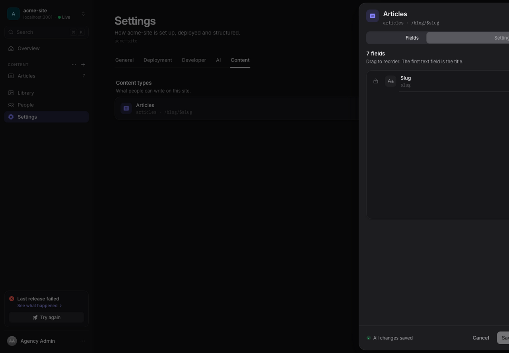

# Content schema

An Areca site schema tells the CMS which collections and fields editors can
use. Define the schema in the website project, then push it to the CMS. The
same collection keys and fields describe the published JSON your website
reads.

## Define a collection

Create or edit `areca.config.ts`:

```ts
import { defineSiteContent } from '@areca-cms/site-sdk'

export default defineSiteContent({
  siteKey: 'acme-site',
  collections: {
    articles: {
      route: '/blog/$slug',
      label: 'Articles',
      fields: [
        { key: 'title', label: 'Title', type: 'text', required: true },
        { key: 'slug', label: 'Slug', type: 'slug', required: true },
        { key: 'body', label: 'Body', type: 'richtext', required: true },
        { key: 'cover', label: 'Cover', type: 'image' },
      ],
    },
  },
})
```

`siteKey` identifies the site created in Areca. A collection key (`articles`)
is the stable identifier used in SDK calls and generated filenames. `route`
documents the route pattern the frontend uses for entries. It does not create a
route automatically. `label` is the human-readable CMS name and is optional.

Push a changed schema from the frontend project:

```bash
pnpm exec areca manifest push
```

The SDK CLI needs `ARECA_CMS_URL`, `ARECA_SITE_TOKEN`, and
`ARECA_SCHEMA_TOKEN` for this command. The manifest POST is authorized by the
schema token; the SDK client also requires the site token when it is created.
The CLI defaults to
`./areca.config.ts`; pass a different path as an argument if needed.

## Field definitions

Every field has a unique `key`, an editor-facing `label`, and a `type`. Keys
must begin with an ASCII letter and use at most 64 ASCII letters, numbers,
underscores, or hyphens. `required` defaults to false. Optional `description`
adds editor guidance.

| Type | Use it for | Type-specific setting |
| --- | --- | --- |
| `text` | Short plain text, such as a title | — |
| `textarea` | Plain text that may span multiple lines | — |
| `richtext` | Formatted article or page body | — |
| `image` | An uploaded image | — |
| `date` | A date without a time | Optional `after` field key |
| `datetime` | A date and time | Optional `after` field key |
| `select` | One value from a fixed list | `options: ['news', 'updates']` |
| `reference` | A link to an entry in another collection | `collection: 'authors'` |
| `slug` | URL-friendly entry identifier | — |
| `boolean` | True/false choice | — |
| `number` | Numeric value | — |
| `url` | A web address | — |

Example of selection, reference, and date ordering:

```ts
fields: [
  { key: 'category', label: 'Category', type: 'select', options: ['news', 'updates'] },
  { key: 'author', label: 'Author', type: 'reference', collection: 'authors' },
  { key: 'publishedAt', label: 'Published at', type: 'datetime' },
  { key: 'expiresAt', label: 'Expires at', type: 'datetime', after: 'publishedAt' },
]
```

`after` names another date or datetime field and means this value must be on or
after it. A reference points at the collection key, not its display label.
Select options are the allowed values.

## Keep the CMS and frontend in sync

The local config is the version-controlled source you can review. The CMS
stores the schema editors currently use. Push after a local change:

```bash
pnpm exec areca manifest push
```

To generate a local config from the CMS's enabled collections:

```bash
pnpm exec areca manifest pull --config ./areca.config.ts
```

`manifest pull` replaces the complete file, including comments and helper
functions. When the existing config has collections, review the displayed
added/changed/removed summary and confirm before overwrite. Use `--yes` to skip
that prompt in automation. Keep a version-control commit or backup before
pulling over a hand-maintained config.

### What a push changes

A push is the full collection manifest for that site. It creates or updates listed collections and enables them. Collections omitted from the manifest are disabled, including all collections if you push an empty `collections` object; their entries are retained. Reintroducing the same key enables the existing collection again. A push does not migrate entry values or build website routes.

The CMS ensures a required `slug` field exists even when the config omits it. Duplicate field keys and unsafe reference/date-dependency identifiers are rejected. A reference collection and date dependency must name the intended target; entry validation and publication checks enforce content relationships. Before removing a collection or changing required fields, check approved entries and references, update the website templates, and verify a release in a test site. A stale JSON file can remain after `areca pull`; use the latest generated manifest as the collection list.



## How fields appear in website data

The published snapshot has one `<collection-key>.json` file per collection.
Each item has common entry metadata and field values under `data`:

```ts
import { readContent } from '@areca-cms/site-sdk/pull'
import type { ImageValue, RichTextValue, SnapshotEntry } from '@areca-cms/site-sdk'

type Article = SnapshotEntry & {
  data: {
    title: string
    body: RichTextValue
    cover: ImageValue | null
  }
}

const articles = readContent<Article>('src/generated/content', 'articles')
```

The SDK validates collection and field identifiers, but the CMS schema does
not generate a TypeScript type for your application. Define the type that
matches the fields your UI reads. Common SDK value shapes:

- `ImageValue`: `url`, nullable `width` and `height`, `alt`, and `mimeType`.
- `RichTextValue`: source `markdown`, parsed `document`, source `json`, and
  static `html`. Render with the TanStack Markdown renderer where possible.
- `ReferenceValue`: referenced `collection`, `slug`, and `id`.

Optional fields may be absent or empty according to their field type and
content. Treat image fields as nullable and check optional values before
rendering. Entries also have `id`, `slug`, `publishedAt`, and optional resolved
`seo` metadata. See [the SDK guide](SDK.md) for pulling,
rendering, preview, and SEO examples.

## Key restrictions

Keys must match `[A-Za-z][A-Za-z0-9_-]{0,63}`. Keys are case-sensitive for CMS
data, but reserved names are checked without regard to case. Reserved names
include `manifest`, `__proto__`, `prototype`, `constructor`, and Windows device
names such as `CON` and `LPT1`. Rename invalid existing keys in the CMS before
syncing or pulling. The SDK also guards output paths and rejects symbolic-link
targets while writing generated files.
