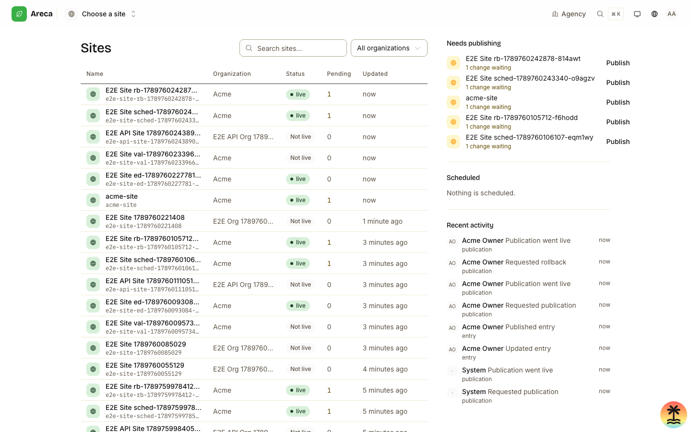
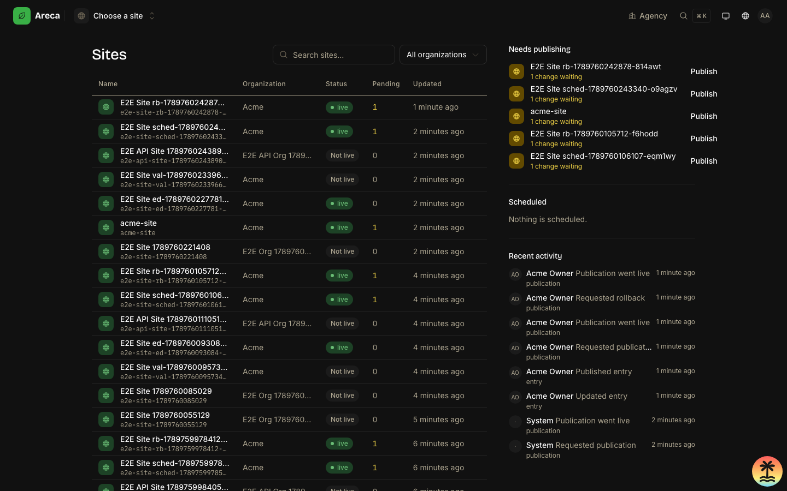

# Areca CMS design guide

How the Areca CMS interface is built: token layers, type scale, layout patterns, and the rules a new screen must satisfy. Everything below is verified against `apps/cms/src`; if code and document disagree, the code wins.

## 1. Principles

**The TanStack design system is the foundation.** The primitive ramps, the `text-ds-*` type scale and the motion curves come from TanStack's system and are declared once in `apps/cms/src/styles.css`; contributors extend that system rather than inventing a parallel one.

**Pages are flat; boxes are for overlays.** A page is a column of sections separated by hairlines, not a grid of cards, so the eye follows content instead of counting containers. The single boxed surface (`Surface`) is reserved for overlays, the editor inspector and the release panel.

**One accent, used sparingly.** Green (`--color-action-primary`) marks the primary action, the active tab underline and live state, and nothing else; status colours carry meaning, never decoration.

**Light and dark are equal.** Both modes are first-class token sets in `styles.css`, not a filter over one another, so every screen must be checked in both before it ships.

**Medium density.** Controls are 32px to 40px tall, the identity strip is 44px, and section spacing is generous but not airy, because editors work in this product all day and want to see a list without scrolling.

## 2. Tokens

Tokens live in `apps/cms/src/styles.css` in three layers.

1. **Primitive ramps** (`--color-ds-green-100` … `--color-ds-neutral-tint-200`). Raw hues from the design system. Components must not use these directly; the only exceptions in the codebase are `::selection` in the base layer.
2. **Semantic tokens** (`--color-text-*`, `--color-background-*`, `--color-border-*`, `--color-icon-*`, `--color-action-*`, `--color-status-*`). Declared light-first inside `@theme` and overridden in the `html.dark` block. These are what you write in components, as Tailwind utilities such as `text-text-muted`, `bg-background-surface`, `border-border-subtle`.
3. **shadcn aliases** (`@theme inline`). `--color-background`, `--color-foreground`, `--color-primary`, `--color-muted-foreground`, `--color-sidebar-*` and friends are aliased onto the semantic tokens, so upstream shadcn class names such as `bg-background` and `text-muted-foreground` keep resolving and stay mode-aware.

**Light and dark.** Theme is a class on `<html>`, applied by `ThemeProvider` in `apps/cms/src/components/theme.tsx` (next-themes, `attribute="class"`, `defaultTheme="system"`, storage key `areca.theme`). `ThemeToggle` offers light, dark and system. `:root` and `html.dark` also set `color-scheme` so native controls follow.

**Whitelabel branding.** `apps/cms/src/lib/branding.ts` derives a palette from an instance accent colour and emits CSS that overrides the same semantic variables. `accentVariables` rewrites `--color-action-primary`, `--color-action-primary-hover`, `--color-action-primary-text`, `--color-text-accent`, `--color-icon-accent` and `--color-status-success`; advanced branding maps named slots (`background`, `surface`, `border`, `primary`, `sidebar`, and so on) onto semantic variables. `brandingCss` emits one block per mode, `:root:not(.dark)` and `html.dark`, and may also override `--font-sans` with one of the fonts in `FONTS`. This is exactly why components must never hardcode a colour: branding only reaches what goes through a token.

| Group | Tokens |
| --- | --- |
| Text | `text-primary`, `text-secondary`, `text-muted`, `text-disabled`, `text-inverse`, `text-accent`, `text-success`, `text-warning`, `text-error`, `text-info` |
| Background | `background-default`, `background-surface`, `background-elevated`, `background-subtle`, `background-inverse`, `scrim`, `surface-state-hover`, `surface-state-pressed`, `input-bg-hover` |
| Border | `border-default`, `border-strong`, `border-subtle`, `border-focus`, `border-error`, `border-success` |
| Icon | `icon-default`, `icon-accent`, `icon-muted`, `icon-success`, `icon-warning`, `icon-error` |
| Action | `action-primary`, `action-primary-hover`, `action-primary-text`, `action-secondary`, `action-secondary-hover`, `action-destructive`, `action-disabled` |
| Status | `status-success`, `status-success-bg`, `status-warning`, `status-warning-bg`, `status-error`, `status-error-bg`, `status-info`, `status-info-bg` |

**Radius.** `--radius-control` (8px) for buttons, inputs and small tiles; `--radius-surface` (12px) for panels and overlays. The shadcn scale `--radius-sm|md|lg|xl|2xl` maps onto those two values so upstream components stay consistent.

**Shadow.** `--shadow-xs` through `--shadow-2xl`. Shadows are for things that float: popovers, drawers, the sticky `SaveBar`. `Surface` deliberately has none.

**Motion.** `--motion-duration-fast` (180ms) and `--motion-duration-sheet` (280ms), with `--motion-ease-standard` and `--motion-ease-sheet`. Named animations are registered as `--animate-dialog-panel-in|out`, `--animate-dialog-scrim-in|out`, `--animate-drawer-{right,left,bottom}-{in,out}`, `--animate-ds-enter-rise` and `--animate-ds-pop-in`. A global `prefers-reduced-motion` block reduces animation and transition durations to near zero; components using `motion/react` additionally call `useReducedMotion` and skip the animation.

**Z.** Only four values exist, on `:root`: `--z-navbar` (100), `--z-scrim` (999), `--z-overlay` (1000), `--z-above-overlay` (1200), exposed as the utilities `z-navbar`, `z-scrim`, `z-overlay`, `z-above-overlay`. Nothing else may set a `z-index`. `--navbar-height` (58px) and its alias `--app-header-h` position sticky bars below the navbar.

## 3. Typography

Three families: **Bricolage Grotesque Variable** for display and headings (`--font-display`), **Inter Variable** for UI and body text (`--font-sans`, also the `body` default), and **IBM Plex Mono** for identifiers, slugs, keys and timestamps (`--font-mono`). All three are self-hosted through fontsource.

Do not combine a font utility with a size utility. The scale is registered as `@utility text-ds-*` so the family, size, line height and weight travel together.

| Utility | Size / line height | Typical use |
| --- | --- | --- |
| `text-ds-heading-1` | 36 / 41 | Entry title input in `EntryCanvas` |
| `text-ds-heading-2` | 28 / 34 | `PageHeader` with `size="lg"` |
| `text-ds-heading-3` | 24 / 29 | Large page-level headings |
| `text-ds-heading-4` | 20 / 25 | `Section` and `PageSection` titles, `PageHeader` `size="sm"` |
| `text-ds-heading-5` | 16 / 21 | `CardTitle`, `EmptyState` title |
| `text-ds-heading-6` | 14 / 18 | Small group headings |
| `text-ds-body-lg` | 18 / 28 | Lead paragraphs |
| `text-ds-body-md` | 16 / 24 | Long-form body |
| `text-ds-body-sm` | 14 / 20 | Default descriptive text |
| `text-ds-body-xs` | 12 / 17 | Fine print and meta rows |
| `text-ds-label-md` | 14 / 17 | Identity strip name, nav links, form labels |
| `text-ds-label-sm` | 12 / 14 | Dense labels and chips |
| `text-ds-mono-sm` | 14 / 21 | Code and long identifiers |
| `text-ds-mono-xs` | 12 / 16 | Slugs and ids in headers and tables |
| `text-ds-mono-caps` | 12 / 14, uppercase | Small section eyebrows |

Columns of numbers get the `.tnum` class for tabular figures. Rich text is rendered inside `.prose`, whose Tailwind typography variables are remapped onto semantic tokens.

## 4. Icons

Icons come from `@phosphor-icons/react` and are imported by name. Default sizing is handled by the primitives: buttons force `size-4` on any child SVG (`size-3` for the `xs` sizes), and badges force `size-3`. Prefer inheriting that over setting a size by hand; use `size-5` or `size-6` only for deliberate focal points such as an `EmptyState` glyph.

Weight is `regular` by default. `duotone` is reserved for `EntityIcon`, and `bold` for the spinner and similar small marks.

`EntityIcon` (`apps/cms/src/components/entity-icon.tsx`) is the convention for naming an entity: a rounded tile holding a duotone glyph, with `tone` of `brand`, `muted`, `warning` or `success` and `size` of `sm`, `md` or `lg`. It is aria-hidden, so the readable name must always sit next to it.

## 5. Layout patterns

**Navbar and site switcher.** `apps/cms/src/components/navbar.tsx` is the sticky top bar at `--navbar-height`, holding the `BrandMark`, the `SiteSwitcher`, the command palette trigger, the language switcher, the theme toggle and the user menu. `apps/cms/src/components/site-switcher.tsx` is a popover on wide screens and a drawer below 900px, and is reachable with the `g s` shortcut; `apps/cms/src/components/command-palette.tsx` is the Cmd/Ctrl+K jump menu across sites, sections and collections.

**Identity strip and section tabs.** `apps/cms/src/components/identity-strip.tsx` renders the 44px band directly under the navbar that names what the page is about. `SiteIdentityStrip` shows the site icon, name, live dot, slug and an open-live-site button, with `SiteTabs` pushed to the right; `OrgIdentityStrip` does the same for an organization. Tabs use the `.nav-tab` component class, which draws the accent underline from `aria-current="page"` or `data-state="active"`.

**Collections rail.** The Content screen (`apps/cms/src/components/content/content-page.tsx`) is a two-column grid, `lg:grid-cols-[260px_minmax(0,1fr)]`, with `collections-rail.tsx` on the left and `entries-pane.tsx` on the right. The rail lists collections with counts, grows a filter input past eight rows, and exposes per-collection actions in a menu.

**Canvas and inspector editor.** `apps/cms/src/components/editor/entry-editor.tsx` lays out `lg:grid-cols-[minmax(0,1fr)_320px]`: `editor/canvas.tsx` is the borderless writing surface (title input plus long-form fields, max width 760px) and `editor/inspector.tsx` is the sticky right panel with `fields`, `details` and `revisions` segments. Below `lg` the inspector moves into a right-side `Sheet`. `editor/editor-toolbar.tsx` replaces the identity strip inside the editor.

**SectionedPage, anchor rail and SaveBar.** `apps/cms/src/components/section-nav.tsx` exports `SectionedPage` (a sticky anchor list plus `PageSection` blocks, with an optional right-hand `aside` column for previews) and is used by site settings, branding and the organization page. Long forms end with `apps/cms/src/components/save-bar.tsx`, a sticky bar that renders only when `dirty` is true and owns the save and saving labels.

**Drawers versus dialogs.** Use a `Sheet` (`src/components/ui/sheet.tsx`) for editing something with its own shape: the collection drawer, the asset panel, the mobile inspector. Sheets default to `anchor="navbar"` so they sit below the sticky bar. Use `Dialog` or `ConfirmDialog` for a short decision, and `ConfirmDialog` with `confirmText` for irreversible deletes.

**Surface versus Section.** `Section` (`src/components/section.tsx`) is the default: a flat block with a hairline above it and no box. `Surface` (exported from `src/components/ui/card.tsx`, with `Card` kept as an alias) is the bordered, rounded-surface box, and belongs only to overlays, the inspector and the release status bar.

## 6. Components

shadcn primitives in `apps/cms/src/components/ui` are **owned code**, not a vendored dependency. Edit them in place when the system needs to change, so the change lands everywhere at once; do not fork a primitive into a feature folder.

| Component | Path | Purpose |
| --- | --- | --- |
| `PageHeader` | `src/components/page-header.tsx` | Page title, description and actions |
| `Section` | `src/components/section.tsx` | Flat page section with hairline and actions |
| `SectionedPage`, `PageSection` | `src/components/section-nav.tsx` | Anchor rail plus long-form sections |
| `SaveBar` | `src/components/save-bar.tsx` | Sticky unsaved-changes bar |
| `IdentityStrip`, `SiteTabs` | `src/components/identity-strip.tsx` | Context band and section tabs |
| `EntityIcon` | `src/components/entity-icon.tsx` | Tinted tile in front of an entity name |
| `EmptyState` | `src/components/empty-state.tsx` | Flat empty state with one action |
| `QueryError` | `src/components/query-error.tsx` | Inline failed-query block with retry |
| `DataTable` | `src/components/data-table.tsx` | Sortable, optionally client-paged table |
| `ListPagination` | `src/components/list-pagination.tsx` | Prev/next for server-paged lists |
| `FormField` | `src/components/form-field.tsx` | Label, control, description, hint, error |
| `ConfirmDialog` | `src/components/confirm-dialog.tsx` | Confirmation, optional typed confirmation |
| `CommandPalette` | `src/components/command-palette.tsx` | Cmd+K navigation |
| `SiteSwitcher` | `src/components/site-switcher.tsx` | Current site and site list |
| `Timeline`, `RelativeTime` | `src/components/timeline.tsx` | Single-rail activity list and time labels |
| `BrandMark`, `BrandLogo` | `src/components/brand-mark.tsx` | Whitelabel logo and app name |
| `Spinner` | `src/components/ui/spinner.tsx` | The only spinner, 16px, `currentColor` |

## 7. States

**Empty.** Use `EmptyState` with a title, one sentence of description and at most one action. It is flat by design; do not wrap it in a `Surface`.

**Loading.** Lists and tables use `Skeleton` (`src/components/ui/skeleton.tsx`, plus `admin/table-skeleton.tsx` and `home/home-skeleton.tsx`) shaped like the content that is coming. In-flight actions use `Spinner` inside the triggering button. Never show a spinner where a skeleton would preserve layout.

**Error.** Failed queries render `QueryError` inline, with the server message and a retry button. Failed actions raise a toast through `sonner`. Form-level failures stay next to the form; auth uses `AuthError` in `src/components/auth-shell.tsx` for exactly that reason.

## 8. Adding a screen

- Use semantic tokens and `text-ds-*` utilities only. No raw hex, no `--color-ds-*` in components, no ad-hoc font sizes.
- Reach for `Section`, `PageHeader`, `EmptyState`, `QueryError` and `FormField` before writing new layout; add a shared component if the pattern repeats.
- Check the screen in light and dark, and with a non-default branding accent.
- Respect reduced motion: rely on the global media query and call `useReducedMotion` in any `motion/react` component.
- Add message keys to all three files, `apps/cms/messages/{en,nl,tr}.json`, using the existing prefixes: `admin_`, `editor_`, `sites_`, `shell_`, `home_`, `auth_`, `shared_`, `media_`, `releases_`, `content_`, `ui_`, `server_`.
- Give the container and every interactive control a stable kebab-case `data-testid` (for example `collection-drawer`, `add-field`, `confirm-action`); tests target these, never class names.
- Update or add the Playwright specs in `apps/cms/e2e` that cover the flow.

## 9. Screenshots

| Light | Dark |
| --- | --- |
|  |  |
|  |  |
|  |  |
|  |  |
|  |  |
|  |  |
