# Areca CMS design system

How the Areca CMS interface is built: principles, tokens, type, shape, motion, the primitives and when to use each, the shell, the recurring patterns and the rules every new screen follows. It describes `apps/cms/src` as it is; if the code and this guide disagree, fix one of them in the same change. The original specification, and the few places where the build differs from it, is [`docs/design/brief.md`](design/brief.md).

| Overview | Collection |
| --- | --- |
| 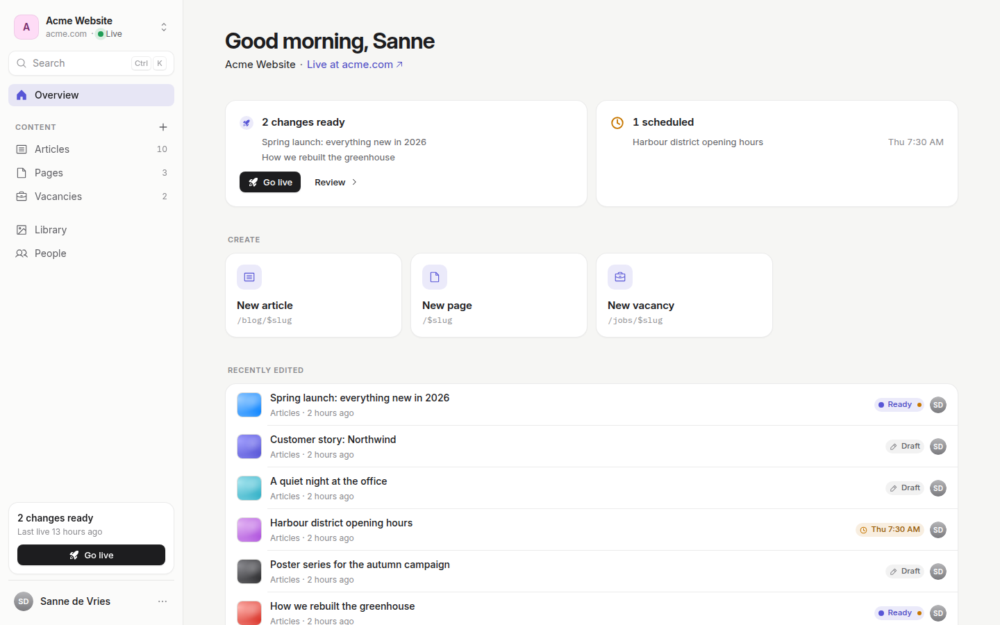 | 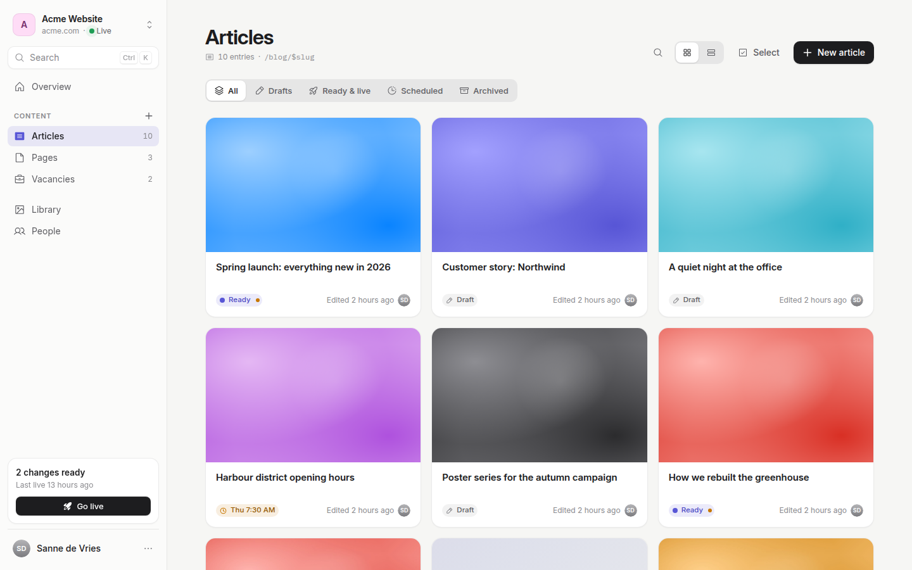 |

## 1. Principles

Four tests every screen passes before it ships:

1. **The newcomer test.** Someone who has never seen Areca can say what the screen is for and what to do next within five seconds, without reading help text.
2. **The grandparent test.** Someone who used it last month finds the same thing again. A place has one name, one icon and one location. Nothing important hides behind hover.
3. **The one-primary rule.** At most one primary (ink) button per screen. Everything else is quieter.
4. **The whisper rule.** Secondary information (ids, hashes, route patterns, technical errors) is present but quiet: smaller, lighter type, inside a "Details" disclosure, or in a panel.

Language is human. **Go live**, not "Publish site". **Library**, not "Media assets". **People**, not "Members & invitations". **Clients** in the Agency workspace, not "Organizations". **Ready**, not "Published but not deployed". Sentence case, no exclamation marks, no jargon in primary UI; technical words (build job, snapshot hash, application ID) appear only inside technical-details areas.

**Calm by default.** Warm neutral canvas, white surfaces with hairline borders, near-zero shadows. Colour carries meaning (accent = selection/ready, green = live, orange = scheduled/warning, red = failure); it is never decoration.

**Light and dark are equal.** Both are first-class token sets; check every screen in both.

## 2. Tokens

Everything visual comes from CSS custom properties in [`apps/cms/src/styles.css`](../apps/cms/src/styles.css). Components use the Tailwind utilities those tokens generate (`bg-background-surface`, `text-text-secondary`, `border-border-default`, `rounded-card`, `shadow-float`…). **No hard-coded colours in components**: branding can only reach what goes through tokens.

Tokens are declared light-first in `@theme` (so Tailwind generates utilities), overridden for dark in `html.dark, .dark`, and repeated in `:root, .light` so a `.light` subtree inside the dark app (the Branding preview) can opt back in. Theme is a class on `<html>` set by `ThemeProvider` (`components/theme.tsx`, next-themes, `defaultTheme="system"`, storage key `areca.theme`); the account menu offers Light · Dark · Auto.

| Group | Tokens (`--color-…`) | Use |
| --- | --- | --- |
| Canvas and surfaces | `background-default` (canvas `#F6F6F4` / `#0E0E10`), `background-surface` (cards), `background-elevated` (popovers, panels), `background-subtle` (wells, hover fills), `background-inverse`, `sidebar`, `scrim` | Pages sit on the canvas; cards on surface; anything floating on elevated |
| Text | `text-primary`, `text-secondary`, `text-muted`, `text-disabled`, `text-inverse`, `text-accent`, `text-success`, `text-warning`, `text-error` | Primary for content, secondary for descriptions, muted for whispers |
| Border | `border-default` (hairline, 8% black/white), `border-strong`, `border-subtle`, `border-focus`, `border-error` | Hairlines everywhere; strong for outlined controls |
| Icon | `icon-default`, `icon-accent`, `icon-muted`, `icon-success`, `icon-warning`, `icon-error` | |
| Action | `action-primary` (+ `-hover`, `-text`), `action-secondary` (+ `-hover`), `action-destructive` (+ `-hover`) | Buttons |
| Accent | `accent`, `accent-hover`, `accent-soft`, `accent-text`, `accent-contrast` | Selection, focus, links, switches, progress, "Ready" |
| Status | `status-{success,warning,error,info,neutral}` and `-bg` | Pills, attention cards, dots |
| States | `surface-state-hover`, `surface-state-pressed`, `segment-track`, `segment-thumb`, `segment-edge` | Hover fills; segmented controls and tabs |

### Ink and accent

- **Ink** (`--color-action-primary`) is the primary button: `#1D1D1F` with white text; in dark mode `#F5F5F7` with `#111` text. It is never re-tinted.
- **Accent** is iris (Apple systemIndigo), `#5856D6` light and `#7D7AFF` dark, with a 12–16% soft fill. It marks the active nav item (soft fill + accent icon), selection, focus rings, links, switches, progress and the **Ready** status. It is not a second primary button colour; `Button variant="accent"` exists for rare brand moments only.

### The branding contract

Instance branding ([`lib/branding.ts`](../apps/cms/src/lib/branding.ts), edited at **Agency › Branding**) drives the **accent**, never the ink button:

- `accentVariables(hex, mode)` converts the brand colour to OKLCH and emits, per mode, `--color-accent`, `--color-accent-hover`, `--color-accent-soft`, `--color-accent-text`, `--color-accent-contrast`, `--color-text-accent`, `--color-icon-accent`, `--color-border-focus`, `--color-status-info` and `--color-status-info-bg`. Dark mode lifts the lightness so the accent still reads on near-black; chroma is clamped to what sRGB screens render.
- `--color-action-primary*` stays the ink button token.
- Legacy "advanced colours" still map onto their semantic tokens (`background` → `--color-background-default`, `primary` → `--color-action-primary`, …), and the Branding screen offers to clear them.
- The default preset **Areca** = iris + Inter. Fonts are selectable (Inter, Bricolage Grotesque, …); `@fontsource` faces only download when used.
- `lib/branding.ts`, `lib/branding.test.ts` and `e2e/branding.spec.ts` change together.

## 3. Type

Inter Variable everywhere (optical sizing on, `cv11` + `ss03`), IBM Plex Mono for code-like text, tabular figures (`tnum`) for counts and times. The scale is a set of `@utility` classes that carry family, size, line height, weight and tracking together; `cn()` in `lib/utils.ts` knows them, so they merge correctly with `text-*` colours.

| Class | Size/line, weight, tracking | Use |
| --- | --- | --- |
| `text-display` | 32/38, 650, −0.022em | Page titles (`PageHeader`) |
| `text-title-1` | 24/30, 600, −0.018em | Panel titles, large section titles |
| `text-title-2` | 19/26, 600, −0.012em | Card titles, slide-over titles, section headings |
| `text-headline` | 15/22, 600 | Row titles, attention-card titles |
| `text-body` | 14/20, 400 | Default UI (the `body` default) |
| `text-body-lg` | 17/28, 400 | Editor writing, rich text |
| `text-callout` | 13/18, 400 | Secondary text, descriptions in rows |
| `text-caption` | 12/16, 500 | Whispers, meta lines, timestamps |
| `text-overline` | 11/14, 600, +0.06em, uppercase | Sidebar group labels, section overlines |
| `text-mono` | Plex Mono 12/16 | Slugs, ids, hashes, logs, env snippets |
| `text-editor-title` | 40/48, 700, −0.025em | The editor's title input |

There is one scale. The old `text-ds-*` utilities are gone.

## 4. Shape, depth and spacing

- **Radius:** `rounded-control` 10px (buttons, inputs), `rounded-card` 16px (cards, inset groups), `rounded-panel` 20px (slide-overs, sheets; outer corners only), `rounded-thumb` 10px (thumbnails, Library tiles), `rounded-full` for pills and avatars.
- **Borders** are 1px hairlines in `border-default`. Library tiles draw theirs as an overlay above the image so image and file tiles share one edge.
- **Depth:** `shadow-card` (`0 1px 2px` at 4%) for cards; `shadow-raise` for hover lifts; `shadow-float` (`0 12px 40px -8px` at 18%, stronger in dark) plus a hairline for anything floating (popovers, panels, the tray while going live, floating bars, toasts). The `surface-card` and `surface-float` utilities bundle border, background and shadow.
- **Spacing** is 4-based. Page gutters 32px desktop / 16px mobile; content column max 1120px (`--content-max`); card padding 20px (16px in tight mobile cards); inset rows 52–60px with 16px padding.
- **Control heights:** 36px default (`md`), 30px small (`sm`), 28px extra small (`xs`), 44px large (`lg`, auth and mobile primary). Touch targets on phones are at least 44px: `Button` and `SegmentedControl` segments carry the `touch-target` utility (`styles.css`), which on `pointer: coarse` adds an invisible hit area of at least 44×44px without changing how the control looks. Give any other small, positioned tap target the same utility.
- **Z scale** (`z-navbar`, `z-floating`, `z-scrim`, `z-overlay`, `z-above-overlay`): nothing else sets a z-index.
- **Icons:** Phosphor, `regular` weight, 18px in navigation and 16px inline; the active nav item uses `fill` in the accent. Collections get an icon by key (`collectionIcon` in `lib/site-nav.ts`): article/blog/post → Article, page → File, job/vacanc → Briefcase, event → Calendar, product → Tag, team/person → User, else Stack.

## 5. Motion

Library: `motion/react`. Presets in [`lib/motion.ts`](../apps/cms/src/lib/motion.ts):

| Preset | Value | Use |
| --- | --- | --- |
| `SPRING_PANEL` | spring 420 / 36 / mass 0.9 | Slide-overs, sheets, floating bars |
| `SPRING_SMALL` | spring 520 / 40 | Pills, tiles, small reveals |
| `FADE` | 150ms, standard ease | The reduced-motion fallback |
| `EASE_STANDARD` | `cubic-bezier(.2,.8,.2,1)` | CSS transitions (`ease-(--ease-standard)`) |

- **Page transition:** a 180ms fade plus 4px rise on route content (`.page-enter`), which steps aside while a router view transition morphs shared elements (collection card → editor via `view-transition-name: entry-{id}`).
- **Sliding indicators** (`layoutId`) for segmented controls, tabs and the active sidebar item.
- **Staggered reveals** (`Stagger`/`StaggerItem`): 30ms per item, capped at 10, opacity + 6px.
- **Animated status icons:** the live dot pings once every 4s, the going-live ring spins, the scheduled clock ticks once, the saved check draws in, the failed icon shakes once.
- **Go-live tray** animates between states; while a release runs its border pulses.
- Nothing exceeds ~250ms perceived. **Reduced motion:** every animation checks `useReducedMotion()` and collapses to an instant change or `FADE`; the global `prefers-reduced-motion` CSS rule stays as a backstop.

## 6. Primitives

All in [`apps/cms/src/components/ui`](../apps/cms/src/components/ui). Use them; do not build parallel versions.

### Actions

| Primitive | When to use |
| --- | --- |
| `Button` | Every button. `variant`: `primary` (ink, one per screen), `secondary` (filled neutral, the default second action), `outline` (provider buttons, secondary actions on busy surfaces), `ghost`/`quiet` (toolbars, rows, "Review ›"), `link` (inline text actions), `destructive` (confirm buttons only), `accent` (rare). `size`: `xs`, `sm`, `md`, `lg`, `icon*`. `loading` shows a spinner and disables. |
| `SplitButton` | A primary action with related alternatives, e.g. **Mark as ready ▾** (go live now, schedule…). |
| `CopyButton` | Copying a value, with a "Copied" state and optional toast. |
| `DropdownMenu*` | ⋯ menus and split-button menus. Destructive items go last, after a separator, in the error colour. |

### Surfaces and layout

| Primitive | When to use |
| --- | --- |
| `PageHeader` | The top of every page: display title, one quiet description, an optional `meta` whisper line, `eyebrow`, and a right-aligned `actions` cluster with at most one primary. `size="sm"` for section headings inside a page. |
| `Card` | A self-contained block: surface, 16px radius, hairline, `shadow-card`, 20px padding. `interactive` adds the hover lift for grid cards; `padded={false}` for edge-to-edge content. |
| `InsetGroup` / `InsetList` / `InsetRow` / `InsetIcon` | iOS-Settings style lists: rows inside one rounded card, hairlines inset from the leading icon. People, invitations, recently edited, info rows. `InsetRow` takes `leading`, `title`, `subtitle`, `trailing`, `chevron`, `asChild` (for links). |
| `SettingsSection` | Description-left / controls-right settings blocks (see §8.1). `danger` for the danger zone, `bare` to drop the card. |
| `EmptyState` | A friendly empty or "nothing matches" state (§8.5). |
| `QueryError` | "Couldn't load {thing}" with **Try again**; always `data-testid="query-error"`. |
| `Skeleton` | Loading placeholders shaped like the content. Pages render skeletons, not spinners. |
| `Spinner` | Inline busy state inside a control. |
| `Timeline` / `TimelineItem` / `TimelineCard` / `RelativeTime` | Vertical histories: activity, releases, entry history. `RelativeTime` renders "2h ago" with the absolute time as a tooltip. |
| `Stagger` / `StaggerItem` | Revealing lists and grids. |

### Overlays

| Primitive | When to use |
| --- | --- |
| `SlideOver` | The standard panel: 480px (`md`), 560 (`lg`), 720 (`xl`) right slide-over with header, scrolling body and sticky footer; a bottom sheet below 768px (`fit` sizes it to its content). Go-live, Activity, asset detail, invite, new client/site, schema editor, entry details on mobile. `nested` for a panel opened from a panel. |
| `Dialog` | Centred modal for focused, short tasks: the media picker, keyboard shortcuts. |
| `ConfirmDialog` | Every confirmation. Optional type-to-confirm (`confirm-text`); the confirm button is `confirm-action`. Destructive variant for deletes. |
| `AlertDialog*` | Low-level; prefer `ConfirmDialog`. |
| `Popover` | Small anchored forms: the schedule popover (desktop), the link editor, the workspace switcher. |
| `Sheet` | Radix edge sheets used by the mobile shell (Content, More, account, switcher). New panels use `SlideOver`. |
| `Tooltip` / `Hint` | Labels for icon-only buttons and **disabled-with-reason** (`Hint label=… wrapDisabled`). |
| `FloatingBar` (+ `FloatingBarLabel`, `FloatingBarDivider`) | Bottom-centre bars that spring up: the settings save pill and the collection selection bar. |
| `Toaster` | Sonner, bottom-right. It keeps clear of other floating surfaces through `overlay-registry`: left of an open slide-over, at the top while a phone bottom sheet is open, above a floating bar. Toasts confirm; errors that need action stay inline. |
| `Command*` | cmdk primitives behind the command palette, the workspace switcher and pickers. |

### Inputs

| Primitive | When to use |
| --- | --- |
| `FormField` | Label on top, control, hint or error below; wires `htmlFor`/`aria-describedby`. |
| `Input`, `Textarea`, `Label` | Text entry (36px, 10px radius, accent focus ring). |
| `Select` | Choosing one of many (more than four options). |
| `SegmentedControl` | Choosing one of two to four, with a sliding thumb: role switches, view toggles, filters, Light · Dark · Auto. `semantics="radio"` or `"tabs"`. |
| `RadioCards` / `RadioCard` | A choice that needs a sentence of explanation: invite roles, fonts. |
| `Switch` | Instant on/off that saves immediately (content type enabled, agency access). |
| `Checkbox` | Selection in lists (select mode). |
| `Tabs` | Underline tabs with a sliding indicator and `role="tab"`: site settings, client page, schema editor. |

### Identity and status

| Primitive | When to use |
| --- | --- |
| `UserAvatar`, `SystemAvatar` | People (initials on a tinted circle) and actorless events. |
| `Tag` | Small quiet markers: "Off", "You", "Expired", "PDF". Never for status. |
| `StatusPill`, `EntryStatusPill`, `PublicationStatusPill`, `JobStatusPill`, `EditedMarker` | Every status in the product (§9). Animated icons: `LiveDot`, `SpinnerRing`, `ClockIcon`, `CheckDraw`, `FailedIcon`, `StatusIcon`. |
| `Kbd`, `KbdCombo`, `useModifierKey` | Keyboard shortcuts, rendered ⌘ on macOS and Ctrl elsewhere. |

## 7. Shell and information architecture

Everyone works **inside a workspace**: a **site** ("Acme Website") or, for agency admins, the **Agency** workspace. Routes (`apps/cms/src/routes`):

| Route | Screen | Who |
| --- | --- | --- |
| `/login`, `/setup`, `/invite/$token` | Auth: a centred card | public |
| `/` | Resolver: last-used site → the only site → `/agency` (admins) → `/sites` | signed in |
| `/sites` | Site picker, "Your sites" | signed in |
| `/sites/$siteId` | Overview | member |
| `/sites/$siteId/c/$collectionKey` (`/new`, `/$entryId`) | Collection, Editor | member |
| `/sites/$siteId/library` | Library | member |
| `/sites/$siteId/people` (`?invite=1`) | People | owner, admin |
| `/sites/$siteId/settings?tab=general\|deployment\|developer\|ai\|content` | Site settings | admin |
| `/agency`, `/agency/clients`, `/agency/clients/$orgId?tab=…`, `/agency/people`, `/agency/activity?client=`, `/agency/branding`, `/agency/ai` | Agency workspace | admin |

`?panel=golive` and `?panel=activity` on any `/sites/$siteId/**` route open the Go-live and Activity panels. Old URLs (`/admin/*`, `/orgs/*`, `/sites/$id/{media,releases,team,activity}`) redirect in thin route files.

**Desktop sidebar** (`components/shell/sidebar.tsx`, 264px; 768–1023px collapses to a 64px rail): workspace card (switcher), Search (⌘K), Overview, **CONTENT** (every collection with its count; admins see disabled ones with an "Off" tag and a section menu with "Edit structure"), Library, People (owners/admins), Settings (admins), the **Go-live tray**, and the account row (Appearance, Language, Keyboard shortcuts…, Sign out). The Agency sidebar has Overview, Clients, All sites, People, Activity, Branding and a "System" card that appears only when a release failed (hidden on `/agency`, which lists it).

**Mobile** (< 768px): a top bar (workspace, Go-live pill, search, avatar) and a bottom tab bar **Overview · Content · Library · More**; Content and More open sheets.

**Focus mode:** editor routes (`staticData: { shell: 'focus' }`) render without the sidebar, under a slim top bar.

**Command palette** (⌘K): go to pages, collections and sites; "New {singular}"; Go live, Invite people, Upload, Open activity, appearance, language, sign out; Agency pages; and entry search. Shortcuts: `g o`/`g l`/`g p`/`g s`, `n` (new entry), `/` (search the page), ⌘S (save), ⌘. (details panel).

## 8. Patterns

### 8.1 Settings sections

Settings pages (site settings, client settings and deployment, branding) are stacks of `SettingsSection`s: the left column (280px) holds a title and one sentence, the right column a card of controls. Below 900px they stack. Forms save through the **floating save pill** ("Unsaved changes · Discard · Save", `FloatingBar`), which springs up only while the form is dirty. Single toggles and alt text save instantly with a quiet "Saved". The danger zone is the last section, `danger`, with type-to-confirm deletes.

### 8.2 Slide-overs

Any task that needs context of the page behind it opens in a `SlideOver`: details, logs, invites, creation flows. Keep one primary action in the footer; put the destructive action on the left of the footer. Make it addressable by a search param when people will want to link to it (`?panel=golive`, `?invite=1`, `?new=1`). Nested panels (a log opened from the Go-live panel) use `nested`. On phones the panel is a bottom sheet; short ones pass `fit`.

### 8.3 Floating bars

Bottom-centre, centred over the content column, above the mobile tab bar: the settings save pill and the Photos-style selection bar ("3 selected · Mark as ready · Move to draft · Delete · Done"). Only one at a time. They register with `overlay-registry` so toasts rise above them.

### 8.4 Disabled with reason

When a role cannot do something, the control stays **visible but disabled**, with the reason in a tooltip (`Hint` with `wrapDisabled`) or inline: "Only owners can publish. Your changes are saved as a draft and an owner can make them live." (`editorPublishReason`). Views a role may not open at all (People and Activity for editors, Settings for non-admins) are hidden instead.

### 8.5 Empty and error states

- **Empty:** `EmptyState` with an icon, a one-line title that says what is missing ("No articles yet"), one sentence, and the one action that fixes it ("Write the first article"). `card` for page-level empties.
- **Filtered to nothing:** "Nothing matches" with **Clear filters** (collection) or "Nothing matches “…”" with **Clear search** (Library).
- **Load errors:** `QueryError` inline where the content would be ("Couldn't load {thing}" + **Try again**). Toasts are for confirmations, not failures that need a decision.
- **404:** a centred card, "This page doesn't exist", "Go to your workspace".

### 8.6 Activity sentences

Every activity surface (Overview, the Activity panel, Agency overview and Agency › Activity) renders rows through `ActivityTimelineItem` (`features/activity/activity-item.tsx`), with the words from `features/activity/activity-sentence.ts`: one sentence per action in the §9 vocabulary ("Sanne marked “Spring launch” as ready", "moved … back to draft", "Acme Website went live"), the entry title (looked up through the editor's `['entry', id]` cache and linked to the editor; the slug, humanised, for deleted entries), site events told without an actor, consecutive repeats folded into one row ("4 saves"), and the scope as "Acme Website" rather than "Acme · Acme Website". New audit actions get a sentence there; nothing shows a raw action key.

### 8.7 Hints instead of noise

Repeat warnings on every item turn into one quiet summary that filters. Example: the Library shows "18 need a description" in the header meta; the per-tile amber dot appears on hover and while that filter is on.

## 9. Status vocabulary

One vocabulary everywhere, defined once in [`lib/status.ts`](../apps/cms/src/lib/status.ts) and rendered by the status pills.

**Entries** (`ENTRY_STATUS`):

| UI status | Backend truth | Pill |
| --- | --- | --- |
| **Draft** | `status = draft` | grey, pencil |
| **Ready** ("Ready to go live") | `published`, updated after the live release (or nothing live yet) | accent dot |
| **Live** | `published` and in the live release | green dot, soft ping once |
| **Scheduled** | `scheduled`, with the time ("Fri 9:00") | orange clock |
| **Archived** | `archived` | muted box |

A published entry with newer draft edits shows the **Edited since ready** marker. The collection filter "Ready & live" covers both (server `published`).

**Releases** (`PUBLICATION_STATUS`): Waiting (`pending`), Going live (`building`), Live, Failed, Replaced (`superseded`), Rolled back.

**Build steps** (`JOB_STATUS`, `GO_LIVE_STEPS`): Queued → Building → Checking (`validating`) → Deploying → Done (`succeeded`); Failed; Cancelled.

**Tray states** (`useReleaseStatus`): Not live yet · N changes ready · Going live… · Up to date · Last release failed.

Actions: **Mark as ready** (`publishEntryFn`), **Move back to draft** (`unpublishEntryFn`), **Go live** (`requestPublicationFn`), **Restore this version** (rollback). All four are for owners and agency admins.

## 10. i18n

- Every user-visible string goes through Paraglide (`m.*` from `#/paraglide/messages`). No literals in JSX, `aria-label`s or toasts.
- Keys use area prefixes: `shell_`, `overview_`, `collection_`, `editor_`, `golive_`, `activity_`, `library_`, `people_`, `settings_`, `agency_`, `auth_`, `content_model_`. Reuse an existing key when the English still fits. Older prefixes (`admin_`, `sites_`, `content_`, `shared_`) are still used by reused keys; server-side error messages use `server_`.
- Never edit `messages/*.json` by hand. Add keys with `node apps/cms/scripts/i18n-add.mjs keys.json` (English; nl and tr get the English as a placeholder, the product decision "English only for now") and remove them with `--remove key…`. The script writes all three locales atomically.
- `src/lib/i18n.test.ts` fails when en, nl and tr drift (key sets, empty values, `{params}`).
- `pnpm --filter @areca/cms typecheck` recompiles Paraglide before `tsc`.
- Counts use explicit `_one` / `_other` keys; dates and times use `Intl` with the current locale.

## 11. Test ids and state attributes

- Keep a `data-testid` whenever its concept still exists; e2e specs depend on them. Renaming one is a coordinated change with `apps/cms/e2e`.
- New interactive landmarks get kebab-case ids named after the concept, not the component: `invite-member`, `publish-site`, `library-missing-alt-filter`. Lists use `{thing}-{key}` (`entry-{slug}`, `member-row-{email}`, `media-card-{filename}`).
- State lives in attributes tests can wait on: `data-ready` (screen or form loaded), `data-dirty`, `data-status` (backend status), `data-ui-status`, `data-state` (tray, save status), `data-locked`, `aria-pressed`, `aria-busy`.
- Real roles and names: tabs are `role="tab"`, menus have `menuitem`s, radios are radios, labels are wired with `htmlFor` so `getByLabel('Slug')` works. Icon-only buttons have an `aria-label`.
- Every screen root has an id (`site-overview`, `library-page`, `people-page`, `site-settings`, `agency-overview`, …).

## 12. Checklist for a new screen

- [ ] It passes the newcomer, grandparent, one-primary and whisper tests (§1).
- [ ] The route file is thin (gate, load, render); logic lives in hooks under `src/features/<area>/`.
- [ ] It starts with a `PageHeader`; content is in `Card`s or `InsetList`s; settings use `SettingsSection` and the save pill.
- [ ] Only tokens: no hex, `rgb()` or Tailwind palette colours in components; it looks right with a different brand accent.
- [ ] Type uses the scale utilities; numbers use `tnum`.
- [ ] Loading shows skeletons, empty shows `EmptyState`, errors show `QueryError`.
- [ ] Every role is handled: hidden where the role can't open it, disabled-with-reason where it can't act.
- [ ] Every string is an `m.*` key added with `i18n-add.mjs`.
- [ ] Keyboard: everything reachable, visible accent focus ring, panels trap and return focus, icon buttons labelled.
- [ ] Motion uses `lib/motion.ts` presets and respects reduced motion.
- [ ] Checked in light and dark, at 1440, 1024, 768 and 390px (touch targets ≥ 44px on phones; nothing hidden under the tab bar).
- [ ] Test ids and state attributes added (§11); existing ids kept.
- [ ] `pnpm --filter @areca/cms typecheck`, `lint` and `test` are clean.

## 13. Screenshots

Taken at 1440×900 on the seeded demo data (Acme Website).

| Light | Dark |
| --- | --- |
|  | 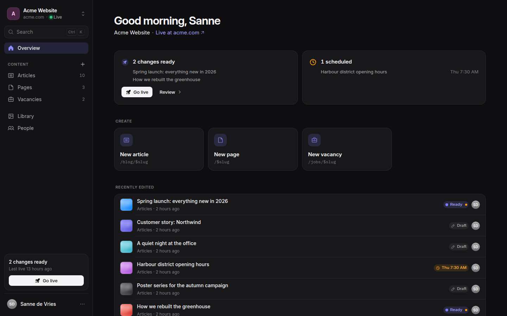 |
|  | 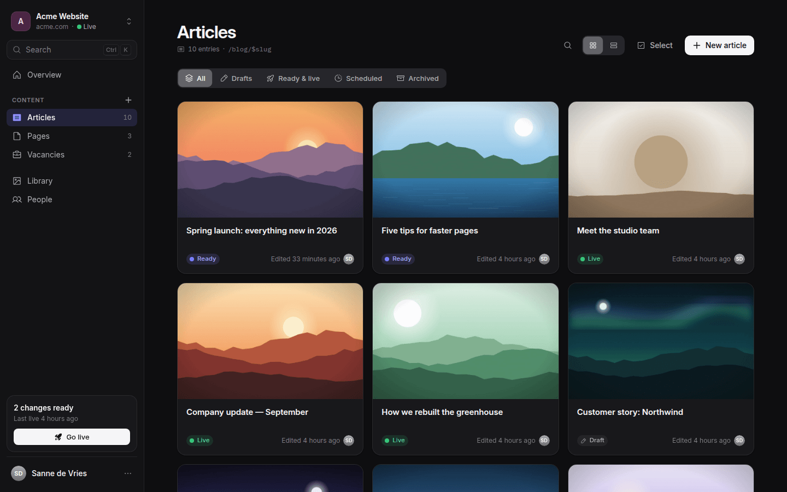 |
| 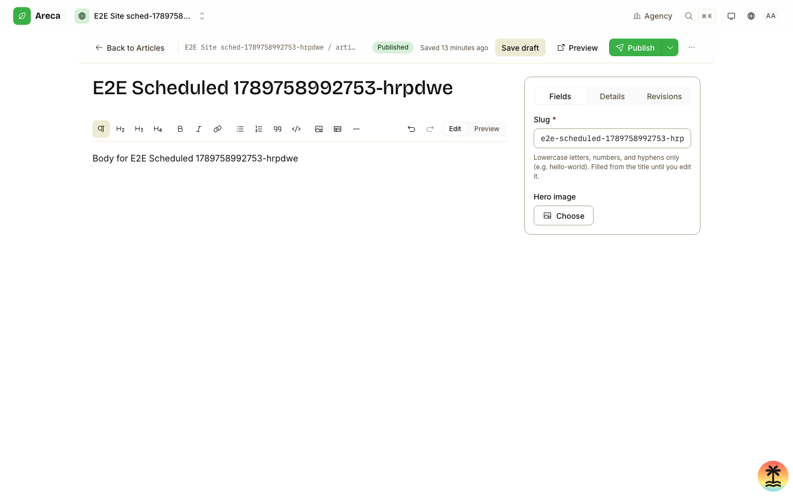 | 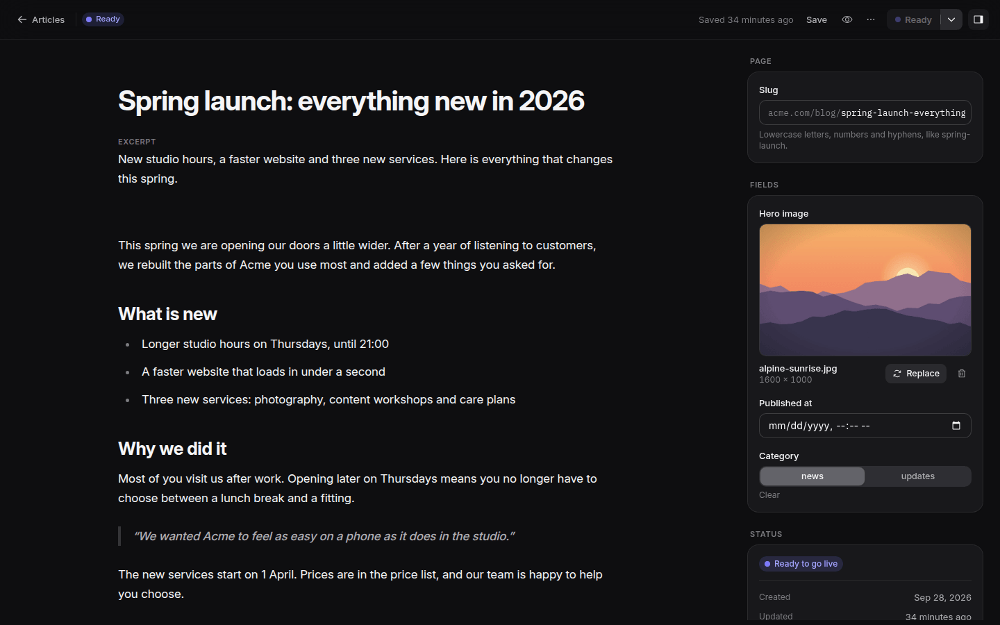 |
| 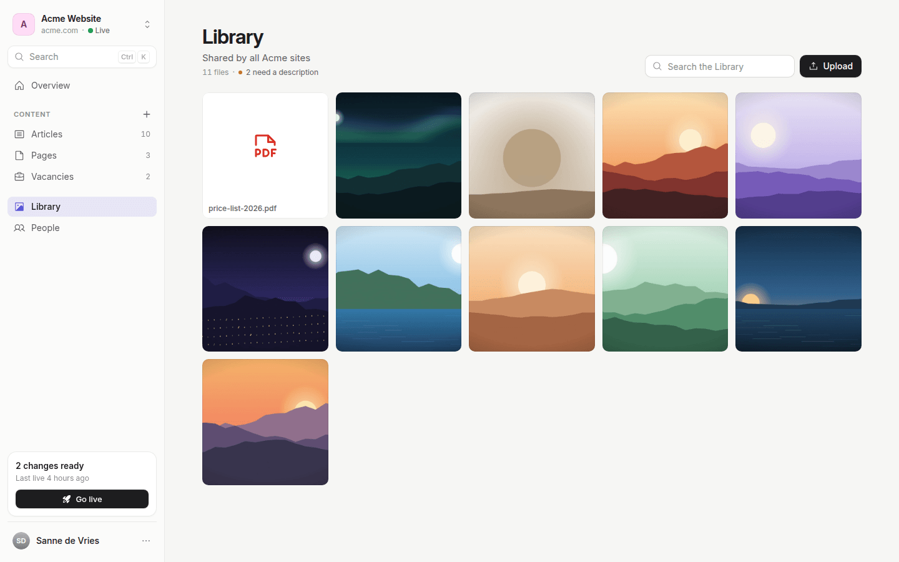 | 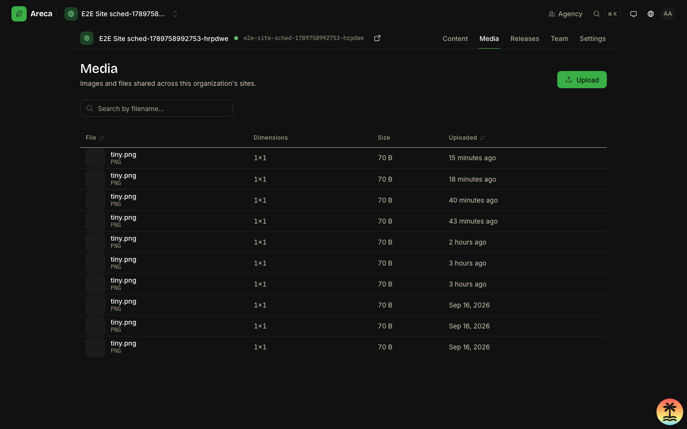 |
| 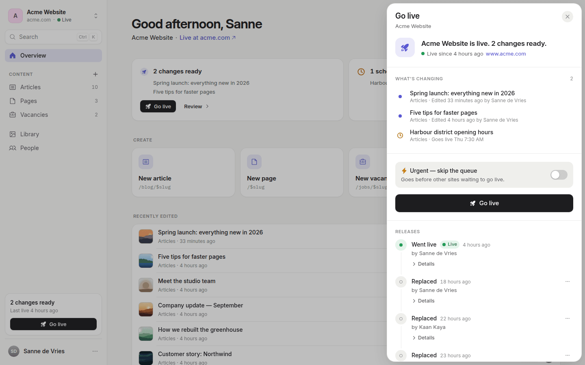 | 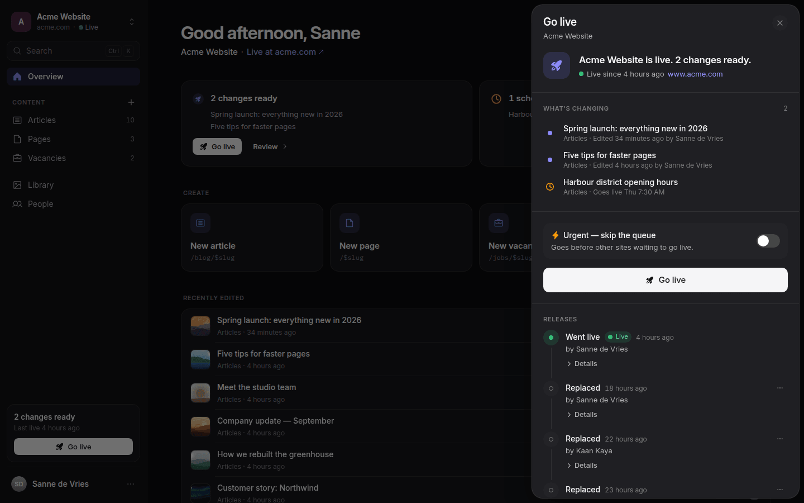 |
| 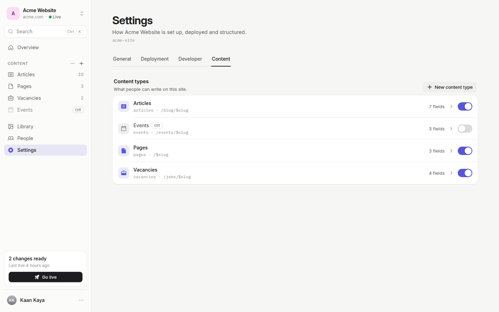 | 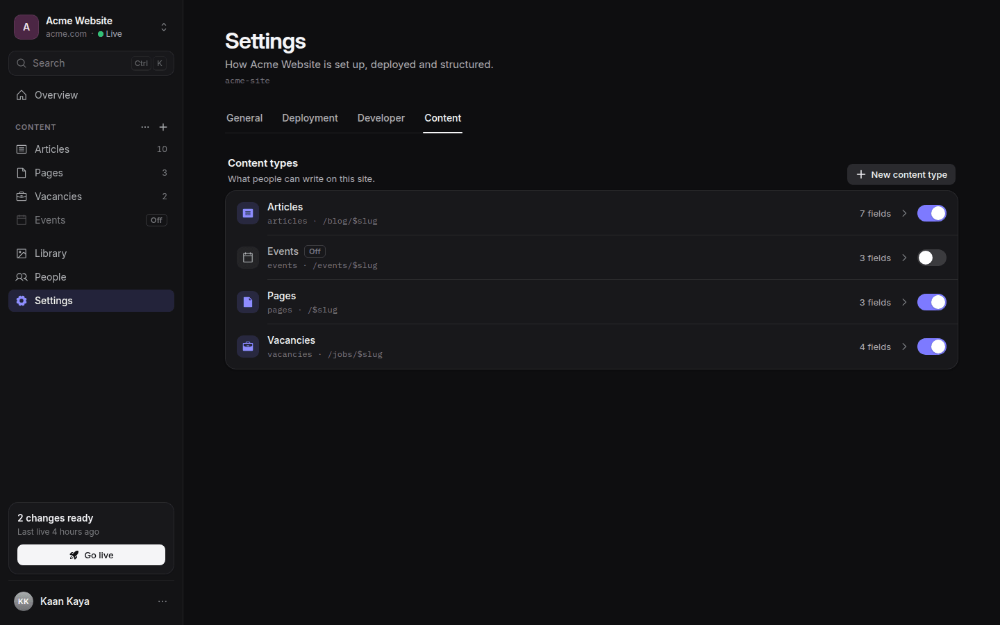 |
