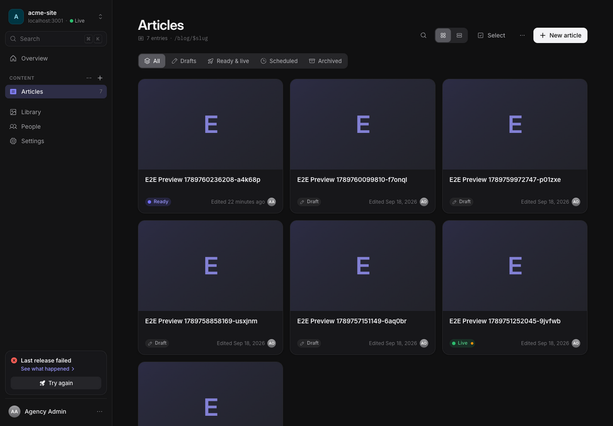
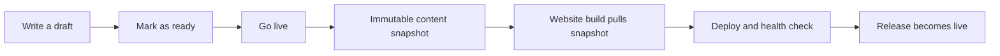

# Areca documentation

Areca is a CMS for agency-managed websites. Write content in the CMS, approve it, then **Go live** to build and deploy the website with a saved version of that content. The SDK connects your website project to the CMS.

Choose the guide that matches what you want to do:

| I want to… | Start here |
| --- | --- |
| Set up Areca for the first time | [First-run onboarding](ONBOARDING.md) |
| Write, preview, and publish website content | [CMS guide](CMS_GUIDE.md) |
| Let Claude, Cursor or another AI app work on a site | [Connect AI (MCP)](MCP.md) |
| Manage clients, sites, people, branding, and AI | [Agency admin guide](ADMIN_GUIDE.md) |
| Connect my own website to Areca | [SDK guide](SDK.md) |
| Define content types and fields | [Content schema reference](CONTENT_SCHEMA.md) |
| Set up page titles, sharing cards, and structured data | [SEO and AI guide](SEO.md) |
| Deploy a customer website | [Deployment guide](DEPLOYMENT.md) |
| Fix a problem | [Troubleshooting](TROUBLESHOOTING.md) |

## Your first successful publish

1. [Start the CMS and create the first admin](ONBOARDING.md).
2. [Create a client and site](ADMIN_GUIDE.md). Keep the site's token in the website's server/build environment.
3. [Define and push the website's content schema](SDK.md).
4. [Create an entry, preview it, and mark it ready](CMS_GUIDE.md).
5. **Go live**, then pull the content into the website's build. For local work choose Demo mode; a Production site requires a configured [deployment target and health URL](DEPLOYMENT.md).

## Understand the pieces

A **client** is an organization. It contains **sites** and has owners and editors. A site contains **collections** (content types such as Articles), which contain **entries** (individual articles). The website project defines how those entries become pages.

A **draft** is editable content. **Ready** means an owner approved a version for the next release. **Live** means a release containing that version successfully went through the publishing pipeline. Saving a draft does not update the public website.

Normal pages use content included in the website build. Draft preview fetches from the CMS. Images can still be served by the CMS asset endpoint, so the CMS must remain reachable for those images unless your website copies them elsewhere.

## Reference and operations

| Guide | Covers |
| --- | --- |
| [Concepts and architecture](ARCHITECTURE.md) | Data model, content versions, publishing, preview, repository map |
| [SDK](SDK.md) | Installation, CLI, client, build integration, rendering, preview, SEO |
| [API](API.md) | Site-token endpoints, snapshot and preview contracts, errors |
| [Configuration](CONFIGURATION.md) | Environment variables, secrets, storage, email, authentication |
| [Permissions](AUTHZ_MATRIX.md) | Server-enforced roles and access rules |
| [Connect AI (MCP)](MCP.md) | OAuth sign-in for connected apps, personal keys, the per-site MCP endpoint, tools, and roles |
| [Operations](OPERATIONS.md) | Health, metrics, logs, worker and incident handling |
| [Recovery](RECOVERY.md) | Backups, restores, organization transfer |
| [Integration reliability](INTEGRATIONS.md) | Deployment delivery, retries, uncertain dispatch recovery |
| [Asset retention](ASSET_RETENTION.md) | Safe media cleanup and references from retained publications |
| [Capacity](CAPACITY.md) | Limits, benchmarks, sizing, tuning |
| [Upgrades](UPGRADES.md) | Migrations, staging, rollback |
| [High-risk upgrades](HIGH_RISK_UPGRADE.md) | Additional verification for sensitive changes |
| [Development](DEVELOPMENT.md) | Local contributor workflow and test isolation |
| [Architecture decisions](DECISIONS.md) | Implementation choices and domain contracts |
| [Design system](DESIGN.md) | UI tokens, components, and patterns |
| [Implementation status](MVP_STATUS.md) | Supported features and deferred work |

The [Docker installation guide](../docker/README.md), [SDK package README](../packages/site-sdk/README.md), and [demo website README](../examples/demo-site/README.md) provide entry points beside their respective packages. The [original project proposal](../PROJECT.md) and [redesign brief](design/brief.md) are historical context; use these guides for current behavior.

## Screenshots

Screenshots show representative screens; your content, theme, branding, and permissions can change what you see. Existing walkthrough images are retained where they still explain the interface. [Screenshot notes](screenshots/README.md) distinguish fresh captures from older reference images.

Examples use placeholders for credentials and show only the relevant code. Replace placeholders with your own values and keep site tokens out of browser code and source control.
