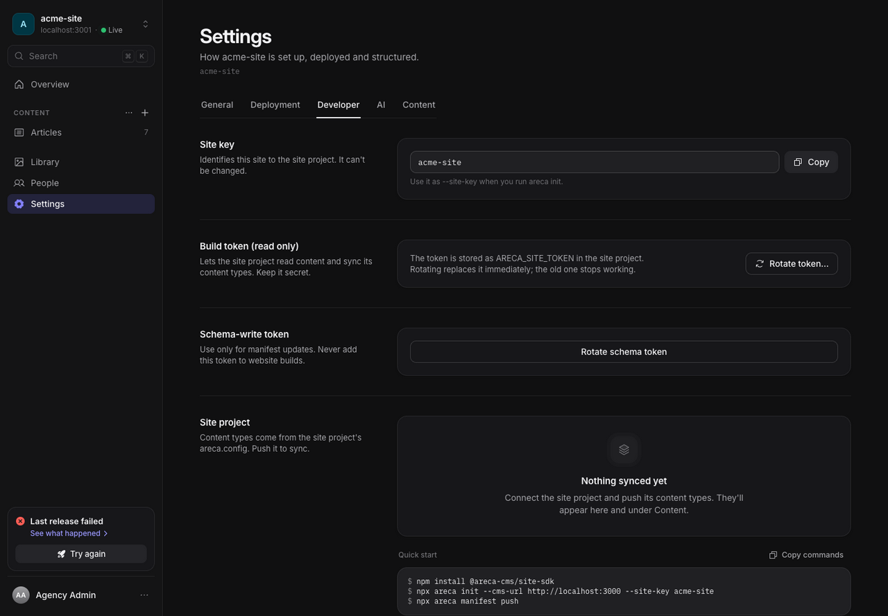

# Use the Areca site SDK

This guide connects a website to an existing site in Areca CMS. You will
declare the content your editors can manage, send that schema to the CMS, pull
a published snapshot, and render the entries in your own routes. The SDK is a
Node.js package and is intended for server loaders, build steps, and scripts.

For all field types and schema rules, see [Content schema](CONTENT_SCHEMA.md).
For the HTTP routes and response types, see [Site API](API.md). The complete
example website lives in [`examples/demo-site`](../examples/demo-site/README.md).

## Before you start

You need:

- A running Areca CMS instance and a site created in that CMS.
- The site's key and **site token**. The CMS shows the site token when it is
  created or rotated; save it in a secret store.
- The separate **schema token** to send schema changes. Find or rotate it in
  the site's Settings under Developer.
- Node.js 22.6 or newer. Node.js 24 LTS is recommended, especially for the
  CLI's native import of `areca.config.ts`.

The site token reads manifests and published snapshots. A signed, expiring
preview token authorizes each draft preview. The schema token writes manifests.
Never place these credentials in a public browser bundle or commit them to Git.



## Install the SDK

In a website project where the SDK package is available from your configured
package registry:

```bash
pnpm add @areca-cms/site-sdk
```

This repository is a pnpm workspace. When you are working inside this
repository, `examples/demo-site` already depends on the workspace package as
`workspace:*`; install workspace dependencies from the repository root with
`pnpm install`. Do not copy the internal `workspace:*` specifier into an
unrelated project. If your registry does not have a published package yet,
install from a release or registry configured by your project maintainer.

The package is ESM-only and does not import React. If your React site renders
rich text, install the Markdown renderer version that matches the SDK's
dependency. This SDK currently uses `@tanstack/markdown` 1.0.0, so install
that compatible version rather than the latest major:

```bash
pnpm add @tanstack/markdown@1.0.0
```

## Initialize your website

Run the interactive initializer from the website's project root:

```bash
pnpm exec areca init
```

Enter the CMS base URL, site token, and site key. The command creates a starter
`areca.config.ts`, `.env.example`, updates the gitignored `.env.local`, adds
the pulled content to `.gitignore` (keeping `areca.gen.ts` tracked), creates an
empty generated manifest, and
adds `sync-manifest` and `content:pull` package scripts when those scripts are
not already defined. If the project has a `dev` script that does not load env
files, init wraps it with `areca run --` so `.env.local` is available.

For automation, provide all required values and `--yes`:

```bash
pnpm exec areca init \
  --cms-url https://cms.example.com \
  --token "$ARECA_SITE_TOKEN" \
  --site-key acme-site \
  --yes
```

Review any existing `areca.config.ts` and `.env.example` before using
`--force`, which allows init to overwrite them. The initializer writes the CMS
URL and site token to `.env.local`; add the schema token to that local file for
schema authoring:

```dotenv
ARECA_SCHEMA_TOKEN=paste-schema-token-here
```

The CLI automatically loads `.env.local`, then `.env`, from the current
directory. Values already in the process environment take precedence.

## Declare the content model

Edit `areca.config.ts` and replace the empty `collections` object with the
content your site needs:

```ts
import { defineSiteContent } from "@areca-cms/site-sdk";

export default defineSiteContent({
  siteKey: "acme-site",
  collections: {
    articles: {
      route: "/blog/$slug",
      label: "Articles",
      fields: [
        { key: "title", label: "Title", type: "text", required: true },
        { key: "slug", label: "Slug", type: "slug", required: true },
        { key: "body", label: "Body", type: "richtext", required: true },
        { key: "cover", label: "Cover", type: "image" },
      ],
    },
  },
});
```

The `siteKey` must match the site created in the CMS. Collection and field keys
are stable identifiers used in entry data and filenames. `route` records the
frontend route pattern; it does not generate routes. Add frontend routes
yourself. See [Content schema](CONTENT_SCHEMA.md) for every field type,
settings, key limits, and synchronization behavior.

## Site content

Site content sections hold single sets of values, such as company details or home-page copy. Declare them under `globals` next to `collections`:

```ts
export default defineSiteContent({
  siteKey: "acme-site",
  collections: { /* ... */ },
  globals: {
    companyInfo: {
      label: "Company info",
      fields: [
        { key: "name", label: "Name", type: "text", required: true },
        { key: "email", label: "Email", type: "text", group: "Contact" },
      ],
    },
    homePage: { label: "Home page", seo: true, previewPath: "/", fields: [/* ... */] },
  },
});
```

`seo` and `previewPath` are optional. The schema rules are in [Content schema](CONTENT_SCHEMA.md#site-content-globals). After a pull, read the values with `content.globals`:

```ts
import { content } from "../generated/content/areca.gen";

const company = content.globals.companyInfo; // { name, email, ... }
const home = content.globals.homePage; // { heroIntro, ..., $seo } when seo is on
```

Each section comes back as a flat object of its values. A section with `seo: true` also has `$seo`, the same shape as an entry's `seo`. Sections the CMS has not made ready yet can be `{}` when they have no required fields. See the [site content guide](/docs/sdk/globals) in the documentation site for the full API, and for how to show a draft.

## Send the schema to the CMS

From the website project root, run:

```bash
pnpm exec areca manifest push
```

The command reads `areca.config.ts` and sends it to the CMS using
`ARECA_SCHEMA_TOKEN`. The CLI also requires `ARECA_CMS_URL` and
`ARECA_SITE_TOKEN` to construct the SDK client. The default config path is
`./areca.config.ts`; specify a path after `push` to use another file:

```bash
pnpm exec areca manifest push ./config/areca.config.ts
```

Only run schema publishing in the trusted authoring environment. Builds and
routine content pulls need the site token, not the schema token. `areca
sync-manifest` remains available as a deprecated alias for `manifest push`.

You can also generate a config from the CMS's enabled collections:

```bash
pnpm exec areca manifest pull --config ./areca.config.ts
```

This replaces the full config file, including comments and helper functions.
If the file already defines collections, the CLI shows an added/changed/removed
summary and asks before replacing it. Use `--yes` for automation. The existing
`siteKey` is preserved; if there is no config, set `ARECA_SITE_KEY` or run init
first.

## Publish and download content

After the schema is synced, create entries in the CMS and publish a release.
Pull its snapshot into your website project:

```bash
pnpm exec areca pull
```

By default, the CLI writes `src/generated/content/manifest.json`, one JSON array
per collection (named after its camelCase key, such as `articles.json`), and the
typed module `src/generated/content/areca.gen.ts`. Commit the module and keep the
JSON out of Git. Add a build step to pull content
before prerendering or compiling the site. A pull fails if the CMS has no
publication; publish from the CMS before building. The SDK rejects unsafe
collection keys and symbolic-link output files.

To use a different output directory:

```bash
pnpm exec areca pull --out .cache/areca-content
```

The generated manifest records publication ID, snapshot hash, creation time,
and collection counts. The published snapshot itself contains all collections
and entries. Treat this snapshot as build input: visitor requests should read
the local generated files rather than call the CMS. A pull overwrites the
manifest and JSON files for collections in the new snapshot, but it does not
delete JSON files for collections removed since an earlier pull. Use the
collection keys in the latest `manifest.json` as the list of current data; do
not discover collections by listing the directory.

### Pull automatically before a build

The CLI loads `.env.local` itself, so a simple package setup can use the CLI
directly. Package managers run `prebuild` before `build`:

```json
{
  "scripts": {
    "prebuild": "areca pull --out src/generated/content",
    "build": "vite build"
  }
}
```

Now `pnpm build` downloads the current snapshot before the frontend build. This
requires `ARECA_CMS_URL` and `ARECA_SITE_TOKEN` and a published CMS snapshot. If
your framework already has a `prebuild` script, add the pull to that script or
call it from your build pipeline. The demo site's more flexible `prebuild`
script pulls when credentials are set, reuses existing generated content when
they are absent, and allows a local fixture when there is no CMS content.

For deployments started by Areca, `areca pull` reads the existing
`ARECA_SNAPSHOT_ID` build argument and requests that exact publication through
`?publicationId=<id>`. The SDK rejects a mismatched response. Empty or `0` values
select the current successful live/demo publication, as do manual pulls without
a pin. Use `areca pull --publication <id>` or
`createArecaClient().fetchSnapshot({ publicationId })` for an explicit selection.
The endpoint scopes every frozen publication to the authenticated site.
The Dokploy adapter sets `ARECA_SNAPSHOT_ID` for each deployment and invalidates
the cached content-pull layer. In a Dockerfile, declare
that argument after dependency/SDK installation and before the build step that
runs `areca pull`; keep the site token mounted as a BuildKit secret. See
[`examples/demo-site/Dockerfile`](../examples/demo-site/Dockerfile) and the
[deployment guide](DEPLOYMENT.md) for the working setup.

## Read typed entries in a server loader

`areca pull` also writes `src/generated/content/areca.gen.ts`. That module is
generated from the schema of the published content and exports a typed
`content` object. Commit it, so your editor and type checker know the types.
The pulled JSON stays out of Git.

```ts
// src/lib/content.ts: server-only module, imported from a server function.
import { content } from "../generated/content/areca.gen";

export function getArticles() {
  return content.articles.all();
}

export function findArticle(slug: string) {
  return content.articles.get(slug);
}
```

Type `content.` and your editor lists the collections. The `where`, `orderBy`,
`limit`, `offset` and `with` options use the field names of each collection, and
only offer the operators that fit each field type. `get` and `byId` return
`undefined` for an unknown value. `resolve(ref)` follows a reference, and
`href(entry)` builds the route from the collection's `route`.

Collection and field names are camelCase in code. The config keeps the raw keys,
so `blog-posts` in `areca.config.ts` is `content.blogPosts` and `cover_image` is
`entry.data.coverImage`. The pull refuses keys that collide after this conversion,
and the names `resolve`, `href` and `preview` cannot be collection keys. See
the typed content guide in the documentation site (`apps/docs/content/docs/sdk/typed-content.mdx`).

Each entry has `id`, `slug`, `publishedAt`, `collection`, `data` and optional
`seo`. Optional fields can be `null`, missing or `''`, and the types show each
case, so check them before you render. Image values include a URL, nullable
dimensions, alt text and MIME type. Rich text includes Markdown source, a TanStack
Markdown AST, its original JSON, and static HTML.

The pull validates every entry against the schema before it writes anything. A
mismatch fails the pull and leaves the previous content and types in place.
Publications made before schemas were embedded fall back to the current CMS schema,
and the pull prints a warning. Go live again to embed the schema.

For lower-level access, `readContent(directory, "blogPosts")` from
`@areca-cms/site-sdk/pull` returns the typed entries of one collection. It takes
no type parameter, because the collection key sets the type. Capture
`readContentManifest(directory)` once and pass it as the third argument when you
read several collections from one publication. `content` does this for you.

`content` and `readContent()` read files at runtime, so ship `src/generated/content/`
(including `.publications/`) with the server build or container. Set
`ARECA_CONTENT_DIR` if the files live somewhere else at run time. For TanStack
Start, call the content object inside a `createServerFn` handler, never in route
or component code. The demo site shows this pattern in
`examples/demo-site/src/lib/content.ts` and `src/lib/queries.ts`.

## Render rich text

The CMS converts validated visual-editor content directly into a TanStack Markdown
document so literal syntax, empty paragraphs, marks, lists, and complex tables retain
their editor structure. The Markdown field is an escaped interoperable export; it
can simplify structures outside its syntax profile. Render the
document with the matching TanStack renderer:

```tsx
import { Markdown } from "@tanstack/markdown/react";
import { richTextComponents } from "@areca-cms/site-sdk/rich-text-react";
import { richTextDocument } from "@areca-cms/site-sdk";
import type { RichTextValue } from "@areca-cms/site-sdk";

export function ArticleBody({ body }: { body: RichTextValue }) {
  return (
    <Markdown components={richTextComponents()}>
      {richTextDocument(body)}
    </Markdown>
  );
}
```

Use the optional `rich-text-react` adapter for React rendering. Explicitly resized
editor images use safe `img` component nodes carrying numeric width/height; the
adapter removes TanStack's generated empty children from these void elements.
Pass your own map as `richTextComponents(myComponents)` to keep custom image
rendering. Keep `max-width: 100%` while respecting supplied dimensions; forcing
`width: 100%` overrides the author's chosen size. The CLI and core SDK do not
import React. Static HTML already contains the chosen dimensions. Plain images
remain standard Markdown image nodes.

`richTextDocument()` also parses Markdown from older snapshots that predate the
document property. `richTextMarkdown()` returns the Markdown export and
`richTextHtml()` returns the static HTML fallback. Prefer the Markdown renderer
when you need to control element rendering. Keep the renderer dependency aligned with the CMS and SDK's TanStack Markdown version (1.0.0).

## Add page metadata

If the snapshot includes SEO metadata, use `seoHead()` in a TanStack Router
route's `head` option. This complete example reads the generated collection in
the server route loader, returns a not-found response for an unknown slug, and
uses that loader result for metadata:

```tsx
// src/lib/content.ts: server-only module, imported by the server function below.
import { content } from "../generated/content/areca.gen";

export function findArticle(slug: string) {
  return content.articles.get(slug);
}
```

```ts
// src/lib/queries.ts: TanStack Start keeps the handler on the server.
import { createServerFn } from "@tanstack/react-start";
import { z } from "zod";
import { findArticle } from "./content";

const loose = { strict: { output: false } as const };

export const loadArticle = createServerFn({ method: "GET", ...loose })
  .validator(z.object({ slug: z.string().min(1) }))
  .handler(({ data }) => findArticle(data.slug) ?? null);
```

```tsx
// src/routes/blog/$slug.tsx: route and page can run in the browser safely.
import { createFileRoute, notFound } from "@tanstack/react-router";
import { Markdown } from "@tanstack/markdown/react";
import { richTextComponents } from "@areca-cms/site-sdk/rich-text-react";
import { richTextDocument, seoHead } from "@areca-cms/site-sdk";
import { loadArticle } from "../../lib/queries";

export const Route = createFileRoute("/blog/$slug")({
  loader: async ({ params }) => {
    const article = await loadArticle({ data: { slug: params.slug } });
    if (!article) throw notFound();
    return { article };
  },
  head: ({ loaderData }) =>
    seoHead(loaderData?.article.seo, { titleTemplate: "%s · Acme" }),
  component: ArticlePage,
});

function ArticlePage() {
  const { article } = Route.useLoaderData();
  const cover = article.data.cover;

  return (
    <article>
      {cover ? (
        
      ) : null}
      <h1>{article.data.title}</h1>
      <Markdown components={richTextComponents()}>
        {richTextDocument(article.data.body)}
      </Markdown>
    </article>
  );
}
```

Keep the content module inside the server function's handler. Do not import
`content` into the route component or browser loader code. This follows the demo's server-function pattern: the route calls
`loadArticle()`, and only its handler reads the generated files.

The helper maps CMS SEO data to title, description, canonical link, robots,
Open Graph, Twitter, author, and JSON-LD fields. `titleTemplate` can be a
`%s`-containing string or a function; `siteName` overrides `og:site_name`.
Missing values are omitted, and older snapshots without `seo` return empty
head data. Render SEO summaries, key takeaways, and FAQ content visibly on the
page when corresponding structured data is present.

For Astro or another server-rendered template, use `seoHeadHtml()` from
`@areca-cms/site-sdk/seo`. It escapes markup and emits safe JSON-LD script
content. `seoJsonLd()` returns the JSON-LD strings if you need to place them
yourself.

## Add a draft preview route

When an editor requests preview from the CMS, it opens your production URL with
a collection, slug, and signed token. Fetch the draft on the server and mark
the response private, uncached, and noindex. The SDK helpers are:

```ts
import { getPreviewEntry, previewHeaders } from "@areca-cms/site-sdk";

const { entry } = await getPreviewEntry({ token });
const headers = previewHeaders();
// Apply headers to the server response and render the entry.
```

`getPreviewEntry()` returns `{ collection, slug, entry }`. Its token is the
opaque preview URL token; it is separate from the site and schema tokens. The
helper returns `X-Robots-Tag: noindex, nofollow` and `Cache-Control: no-store`.
Also set a robots meta tag if your framework renders HTML metadata. Never cache
or log the preview token or draft response. Show a useful message for invalid
or expired tokens and entries that no longer exist.

A preview token can also be for a site content section. Its result has `kind: "global"` and a `global` key instead of `collection` and `slug`. Use `content.previewGlobals()` to overlay the draft on the published values:

```ts
const globals = await content.previewGlobals(token); // string, PreviewResult, or null
```

`previewGlobals` takes the token string, a `PreviewResult` from `getPreviewEntry`, or `null`/`undefined`. A falsy value returns the published `content.globals`. An entry token is ignored and also returns the published values. Preview a section on the page it is shown on: the CMS opens `<site><previewPath>?arecaPreview=<token>` for a section with a `previewPath`, so the route reads `arecaPreview` from the query string.

The demo route at `/__preview/$collection/$slug` shows complete TanStack Start
handling, including query validation, server-side fetch, response headers, and
an error state. Preview pages should be excluded from prerendering.

## Production publishing and health checks

In CMS **Production** publishing mode, Go live requires a deployment target
and a health-check URL. The CMS waits until the deployed site reports the
publication ID it just built before marking that publication live. Point the
health URL at a site route that returns JSON with a top-level `publicationId`,
for example:

```json
{ "ok": true, "publicationId": "the-publication-id" }
```

The demo site's `/api/health` reads `publicationId` from the generated content
manifest and returns HTTP 503 if that manifest is missing. Configure that URL
as the site's health-check endpoint. A TanStack Start route can use this small
implementation (content is already pulled before the build):

```ts
import { readFileSync } from "node:fs";
import { join } from "node:path";
import { createFileRoute } from "@tanstack/react-router";

export const Route = createFileRoute("/api/health")({
  server: {
    handlers: {
      GET: () => {
        try {
          const path = join(
            process.cwd(),
            "src/generated/content/manifest.json",
          );
          const manifest = JSON.parse(readFileSync(path, "utf8"));
          if (
            typeof manifest.publicationId !== "string" ||
            !manifest.publicationId
          ) {
            throw new Error("Publication ID missing");
          }
          return Response.json({
            ok: true,
            publicationId: manifest.publicationId,
          });
        } catch {
          return Response.json({ ok: false }, { status: 503 });
        }
      },
    },
  },
});
```

The file-based route reads `src/generated/content/manifest.json` at runtime,
so your deployment must include the generated directory. The demo Dockerfile
does this with:

```dockerfile
COPY --from=build /app/examples/demo-site/src/generated ./src/generated
```

The demo Docker image listens on port 3000. **Demo** publishing mode skips
deployment and health verification and creates a demo snapshot instead; it is
useful while learning the CMS without configuring Dokploy. Production mode
cannot publish until its target and publication-aware health URL are
configured.

## Use the client directly

For scripts and custom build integrations, create a client from environment
variables or explicit options:

```ts
import { createArecaClient } from "@areca-cms/site-sdk";
import { pullContent } from "@areca-cms/site-sdk/pull";

const client = createArecaClient();
const manifest = await client.fetchManifest();
const snapshot = await client.fetchSnapshot();
await pullContent({ outDir: "src/generated/content", client });
```

The client has `fetchManifest()`, `fetchSnapshot()`, `syncManifest(config)`,
and `fetchPreview(token)` methods. `ARECA_CMS_URL` and `ARECA_SITE_TOKEN` are
required to create a client. `syncManifest()` also requires
`ARECA_SCHEMA_TOKEN`. Pass `cmsUrl`, `siteToken`, and `schemaToken` in the
options object when you do not want to use environment variables.

## Common errors

| Message or behavior                               | What to check                                                                                                                                                                                             |
| ------------------------------------------------- | --------------------------------------------------------------------------------------------------------------------------------------------------------------------------------------------------------- |
| Missing `ARECA_CMS_URL` or `ARECA_SITE_TOKEN`     | Set them in the environment or in `.env.local` in the directory where the CLI runs.                                                                                                                       |
| Missing `ARECA_SCHEMA_TOKEN` during manifest push | Get the schema token from the site's Developer settings and set it in the authoring environment.                                                                                                          |
| `401` / unauthorized                              | Check which credential the operation needs and whether it was rotated. Schema push needs the schema token; manifest and snapshot reads need the site token. Preview needs the URL's current signed token. |
| `429` / too many requests                         | Wait for the `Retry-After` seconds in the response, then retry. Site manifest and snapshot routes allow 300 requests per minute per token.                                                                |
| No publication exists                             | Publish content in the CMS, then rerun `areca pull`.                                                                                                                                                      |
| No content file for collection                    | Pull content first and confirm the collection key matches the schema.                                                                                                                                     |
| `Publication does not match its schema`           | Each line names an entry, field and problem. Fix the entry or the schema, publish, and pull again. The pull writes nothing when it fails.                                                                  |
| `Collection keys ... both map to`                 | Two keys have the same camelCase name, such as `blog-posts` and `blog_posts`. Rename one of them in `areca.config.ts`.                                                                                     |
| TypeScript config import fails                    | Use Node 24 or run the CLI through `tsx`, as suggested in the error.                                                                                                                                      |

The client does not retry failed HTTP requests. Network errors include the CMS
URL and underlying fetch detail. HTTP errors include their status and CMS error
message when available. The CLI exits nonzero on an error.

Manifest push can return `400` for an invalid schema or `413` when the JSON
manifest exceeds 256 KiB. The server accepts up to 100 collections and 100
fields per collection. See [API limits](API.md#errors-and-retries) for the
remaining schema limits and rate-limit response details.

## CLI reference

```text
areca init [--cms-url <url>] [--token <token>] [--site-key <key>] [--yes] [--force]
areca pull [--out <directory>] [--types <path>]
areca manifest push [config]
areca manifest pull [--config <path>] [--yes]
areca run -- <command>
```

`areca init` also accepts `--out` and `--config`; its defaults are
`src/generated/content` and `areca.config.ts`. `--yes`/`-y` skips interactive
prompts where supported. Use `--help` to display command usage.
