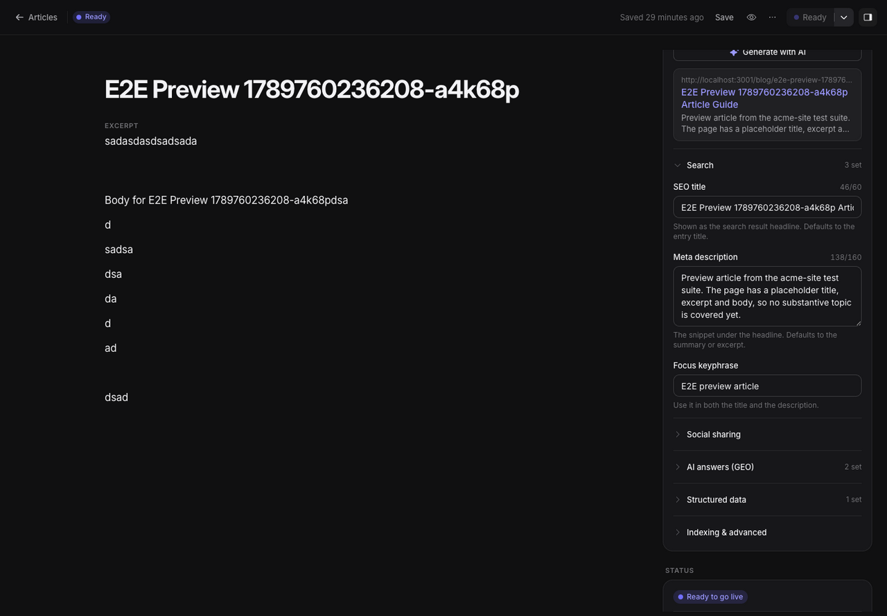
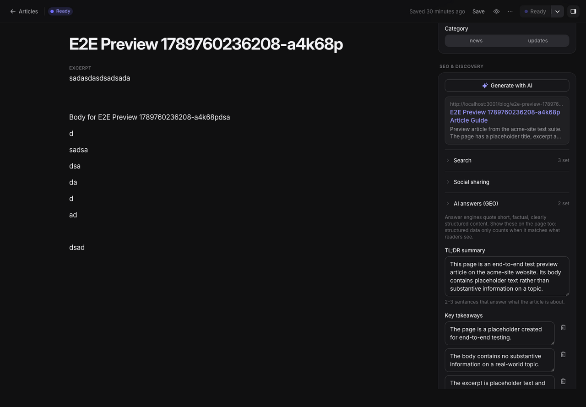

# SEO and structured metadata

Areca stores SEO settings with each entry and includes resolved metadata in the published content snapshot. The connected website must render the snapshot's SEO metadata in its document head for search engines and social platforms to use it. Areca does not promise ranking or indexing outcomes.

## Edit an entry's SEO

Open an entry and expand **Details › SEO & discovery**. The panel groups settings into search, social, answer-focused content, structured data, and advanced options. Fields autosave with the rest of the draft. The preview shows the title, description, and URL that will be used, including fallback values.

| Setting | What it controls |
| --- | --- |
| SEO title and description | Search-result title and description. Empty values fall back to the entry title and a description or summary/body excerpt. Counters show useful targets (about 60 and 160 characters); these are guidance, not hard validation limits. |
| Focus keyphrase | Editorial note identifying the main query the page answers. |
| Canonical URL | Explicit canonical address. If blank, Areca derives one from the production URL, collection route, and entry slug. |
| Noindex / nofollow | Robots directives for the page. Leave both off for normal public content. |
| Social title, description, image | Open Graph share metadata. Values fall back to the search metadata; the image falls back to the entry's first image field. |
| Twitter card | `summary` or `summary_large_image`; the default follows whether an image is available. |
| Summary, takeaways, FAQ | Answer-oriented information included in the snapshot. The summary and FAQ also contribute to generated JSON-LD. Provide factual content supported by the article. |
| Schema type, about, author | Article/page type and optional entity and author details used in structured metadata. |
| Custom JSON-LD | Optional JSON object or array of objects appended to generated structured data. Use only valid, accurate schema data. |

Stored text has server-enforced maximum lengths. The SEO title has a 300-character maximum and description a 1,000-character maximum; the shorter counters are editorial recommendations. Custom JSON-LD is limited to 20,000 characters and must parse as an object or an array of objects.

## Generate suggestions with AI

If AI is configured, choose **Generate with AI** in the SEO panel. Opening the dialog starts generation using the current entry, including unsaved edits. Areca shows the selected model and whether it received text only or images. The dialog lists only changed SEO suggestions: title, description, focus keyphrase, social title and description, summary, key takeaways, FAQ, schema type, and about entities. It can also suggest alt text for images without alt text. It does not generate every SEO field: canonical URL, robots directives, social image, Twitter card, author, and custom JSON-LD remain editorial fields.

Each suggestion is shown with its current value and proposed value. Changed metadata and eligible alt text are selected by default; **Select all / Select none** changes the selection. Click **Apply** to update only the selected SEO fields in the current draft and selected image descriptions in the Library. Click **Cancel** to discard the suggestions. Generation itself does not save or publish anything.

The prompt includes the site and page URL, content type, entry title, other populated fields, rich-text body (with a size limit), current SEO values, and metadata for up to four associated images. If the selected model supports vision, Areca also sends resized image content; a text-only model receives the textual prompt but no image pixels. Image selection covers image fields, the chosen social image, and images embedded in rich text. Do not send confidential or personal information unless the agency has approved that use with its provider. The system prompt instructs the model to follow the article language and avoid unsupported claims, but editors remain responsible for checking every suggestion and alt text.

Agency admins configure provider access, model, and shared prompt at **Agency › AI**. A site-specific prompt can be added at **Site Settings › AI**. Generation is limited to 30 requests per hour per user. If the action is absent, AI may not be configured or available for the current account.

## What ships in a site snapshot

For each entry, Areca resolves title, description, canonical URL, robots directives, Open Graph and Twitter values, author, summary, key takeaways, FAQ, and JSON-LD. The title falls back to the entry title. Description falls back to a supplied description, then the SEO summary, then a plain-text excerpt from the entry. Canonical URL is inferred when the site production URL and collection route are valid. Open Graph and Twitter values use SEO/search fallbacks; images use the chosen social image or the first entry image.

The snapshot also carries focus keyphrase and answer-oriented content for the website integration. Ensure the site template renders the metadata fields and JSON-LD rather than assuming the CMS itself serves page HTML. Preview responses are marked `noindex`; preview content should not be indexed.

## Editorial checks

- Give each public page a distinct, accurate title and useful description.
- Confirm the slug and canonical address match the intended public URL.
- Use noindex for content that should stay out of search; verify this carefully before going live.
- Describe images in their context. Keep alt text concise and avoid repeating nearby copy.
- Keep FAQ answers and structured data consistent with the page body.
- Review the generated result preview, then mark the entry ready and release it.
